# Grout & About

Grout & About is a website for a one-person plumbing and bathroom business in Hackney, London. It shows what the business does, what a repair visit costs, which areas it covers and photos of real bathroom projects. There is one way to get in touch: an enquiry form.

The site was built by the owner of Grout & About for the WAES Full Stack course, using HTML, CSS, Bootstrap 5.3 and JavaScript. The enquiry form sends each enquiry, with any photos or videos, to Google Apps Script, which logs it in a Google Sheet, saves the files to Google Drive and emails a PDF summary to both the owner and the customer (see [Google Apps Script](#google-apps-script)).

**[View the live site](https://code-mca.github.io/grout-and-about/)**

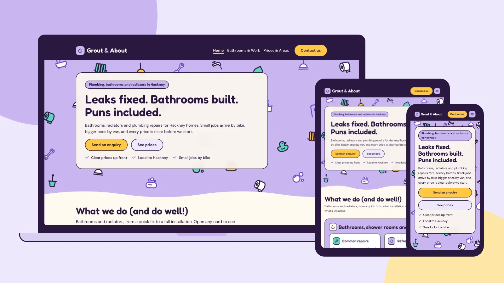

## Contents

- [User Experience (UX)](#user-experience-ux)
  - [Project goals](#project-goals)
  - [Who the site is for](#who-the-site-is-for)
  - [User stories](#user-stories)
  - [How the work was planned](#how-the-work-was-planned)
- [Design](#design)
  - [Colour palette](#colour-palette)
  - [Typography](#typography)
  - [Imagery and icons](#imagery-and-icons)
  - [Design devices](#design-devices)
  - [Tone of voice](#tone-of-voice)
- [Features](#features)
  - [On every page](#on-every-page)
  - [Home](#home)
  - [Bathrooms and Work](#bathrooms-and-work)
  - [Prices and Areas](#prices-and-areas)
  - [Contact us](#contact-us)
  - [Thank you page](#thank-you-page)
  - [Privacy page](#privacy-page)
  - [Future features](#future-features)
- [JavaScript and Google Apps Script](#javascript-and-google-apps-script)
  - [Why the form needs JavaScript](#why-the-form-needs-javascript)
  - [What main.js does](#what-mainjs-does)
  - [Google Apps Script](#google-apps-script)
  - [Photo and video uploads](#photo-and-video-uploads)
- [Changed mid-flight, and why](#changed-mid-flight-and-why)
- [Challenges overcome](#challenges-overcome)
- [Accessibility](#accessibility)
- [Testing](#testing)
- [Deployment and local development](#deployment-and-local-development)
- [Technologies used](#technologies-used)
- [Credits](#credits)

---

## User Experience (UX)

### Project goals

**Business goals**

- Win plumbing, radiator and bathroom work in and around Hackney.
- Be clear about prices before anyone gets in touch, so there are no awkward conversations later.
- Bring every enquiry in through one route, with the details John needs to price the job.
- Build trust by showing real work and the person who will turn up.

**Visitor goals**

- Find out quickly whether Grout & About does my kind of job and covers my area.
- Work out roughly what a repair visit will cost.
- See genuine examples of finished bathrooms.
- Send an enquiry without having to phone.

### Who the site is for

The user stories name eight kinds of visitor: a first-time visitor, a local homeowner, a budget-conscious homeowner, a customer with a plumbing problem, a visitor with a visual impairment, a homeowner planning a new bathroom, a local resident checking the service area, and someone arranging work for a relative.

### User stories

Each story is a GitHub issue with acceptance criteria and tasks. The priority uses MoSCoW (must, should, could have).

| #                                                          | User story                                                                                                                                                                   | Priority | Where it's met                                                                                                                                                                  |
| ---------------------------------------------------------- | ---------------------------------------------------------------------------------------------------------------------------------------------------------------------------- | -------- | ------------------------------------------------------------------------------------------------------------------------------------------------------------------------------- |
| [1](https://github.com/code-mca/grout-and-about/issues/1) | As a **first-time visitor**, I want easy navigation and a layout that works on my phone or computer, so I can find what I need quickly, even without any plumbing knowledge. | Must     | Shared navbar and footer on every page, burger menu below 992px, Bootstrap grid. No sideways scrolling at 390px, 820px, 1280px or 1440px ([tested](TESTING.md#responsiveness)). |
| [2](https://github.com/code-mca/grout-and-about/issues/2) | As a **local homeowner**, I want to see straight away what services are offered, so I can tell whether Grout & About can help with my job.                                   | Must     | Home page hero and the two service panels, each card with a "What's included" drop-down.                                                                                        |
| [3](https://github.com/code-mca/grout-and-about/issues/3) | As a **budget-conscious homeowner**, I want to understand how charges work before I get in touch, so I can avoid surprises and decide whether the job is worth doing.        | Must     | Prices and Areas: price cards, the repair visit calculator, "How we charge, in full" and the six-step bathroom quote process.                                                   |
| [4](https://github.com/code-mca/grout-and-about/issues/4) | As a **customer with a plumbing problem**, I want to send an enquiry describing my job, so I can get a reply without having to phone.                                        | Must     | Contact us form with browser checks, then the thank-you page. Each enquiry is logged and emailed to both sides by Google Apps Script, tested live on 20 November 2026. |
| [5](https://github.com/code-mca/grout-and-about/issues/5) | As a **visitor with a visual impairment**, I want the site to be built in an accessible way, so I can find information and send an enquiry without barriers.                 | Must     | See [Accessibility](#accessibility). axe-core found no violations on any page.                                                                                                  |
| [6](https://github.com/code-mca/grout-and-about/issues/6) | As a **homeowner planning a new bathroom**, I want to see genuine examples of past work, so I can judge the quality before asking for a quote.                               | Should   | Bathrooms and Work: "Recent work", three projects with five photos each.                                                                                                        |
| [7](https://github.com/code-mca/grout-and-about/issues/7) | As a **local resident**, I want to check whether my area is covered, so I know before I make an enquiry.                                                                     | Should   | Prices and Areas: three travel zones and a ward-by-ward map.                                                                                                                    |
| [8](https://github.com/code-mca/grout-and-about/issues/8) | As a **person arranging work for a relative**, I want to know who will be coming to the property, so I can feel confident booking on their behalf.                           | Could    | Bathrooms and Work: "Hi, I'm John" with a headshot, a short video and a photo on the job.                                                                                       |

### How the work was planned

- The user stories were written as GitHub issues before building started, each with acceptance criteria, a task list and a MoSCoW priority.
- A design mockup was made first and linked from Issue 1. It set the layout, palette and components, so there are no separate hand-drawn wireframes.
- The site was then built page by page. The commit history runs from 6 to 20 November 2026.

---

## Design

### Colour palette

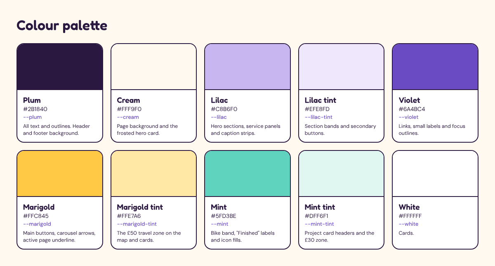

Every colour is set once as a CSS variable in `:root` and reused everywhere. Plum is the only text colour on the coloured backgrounds, and violet text is only used on light backgrounds.

The contrast ratios below were calculated with the WCAG 2 formula from the hex values in `styles.css`. WCAG AA needs at least 4.5:1 for normal text.

| Text on background                | Ratio  | AA normal text                      |
| --------------------------------- | ------ | ----------------------------------- |
| Plum on white                     | 16.1:1 | Pass                                |
| Plum on cream                     | 15.3:1 | Pass                                |
| Plum on mint tint                 | 14.2:1 | Pass                                |
| Plum on lilac tint                | 13.5:1 | Pass                                |
| Plum on marigold tint             | 13.2:1 | Pass                                |
| Plum on marigold                  | 10.4:1 | Pass                                |
| Plum on mint                      | 8.8:1  | Pass                                |
| Plum on lilac                     | 8.7:1  | Pass                                |
| Cream on plum (header and footer) | 15.3:1 | Pass                                |
| Marigold on plum (footer links)   | 10.4:1 | Pass                                |
| Violet on white                   | 6.1:1  | Pass                                |
| Violet on cream                   | 5.9:1  | Pass                                |
| Violet on lilac tint              | 5.2:1  | Pass                                |
| Violet on lilac                   | 3.3:1  | Fail, so this pairing is never used |

### Typography

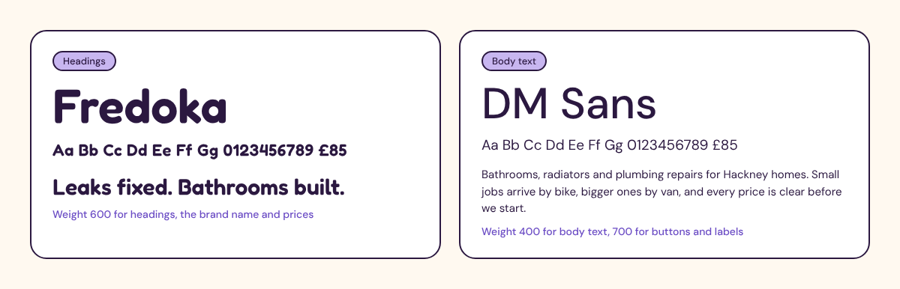

- **Fredoka** (Google Fonts) for headings, the brand name, prices and step titles. Its rounded letters suit the friendly tone.
- **DM Sans** (Google Fonts) for body text, labels and buttons. It stays easy to read at small sizes.
- Both load from Google Fonts with `display=swap`, so text shows in a fallback font while they download.

### Imagery and icons

- **Real photos.** Every project photo is John's own work, saved as WebP. The three projects run from before or in progress through to finished.
- **Bathroom icons.** Twelve icons (bath, shower, loo roll, toilet brush, radiator, spanner, water drop, tap, plunger, rubber duck, soap and bubbles), each in white, gold, mint and cream. They have a plum outline and a solid fill, so the lilac behind them doesn't show through.
- **UI icons.** Small plum line icons on buttons and cards (clock, wrench, map pin and so on).
- **Favicon.** The lilac tile and water drop from the logo, as an SVG plus PNG copies for older browsers and iPhone home screens.
- **Maps.** Two SVG maps of Hackney, Islington and Tower Hamlets, built from Office for National Statistics ward boundaries and coloured by travel charge.

### Design devices

- A lilac hero on every page with bathroom icons that gently bob, a frosted cream card in front (90% opaque with a background blur) and a wavy bottom edge.
- Cards and pill-shaped buttons with a 2px plum outline and rounded corners. Buttons lift slightly on hover.
- A marigold underline for the current page in the navbar.

### Tone of voice

The rule from Issue 2 is "joke in the headline, facts in the body". Headlines carry the puns ("Leaks fixed. Bathrooms built. Puns included.", "Getting around London is pants"). Prices, the quote process, the form and every button use plain words ("Send an enquiry", "See prices").

---

## Features

### On every page

**Navbar.** The brand on the left, links to Home, Bathrooms and Work and Prices and Areas, and a marigold Contact us button. Below 992px the links fold into a lilac burger menu, and Contact us stays visible next to it so the header stays on one line.


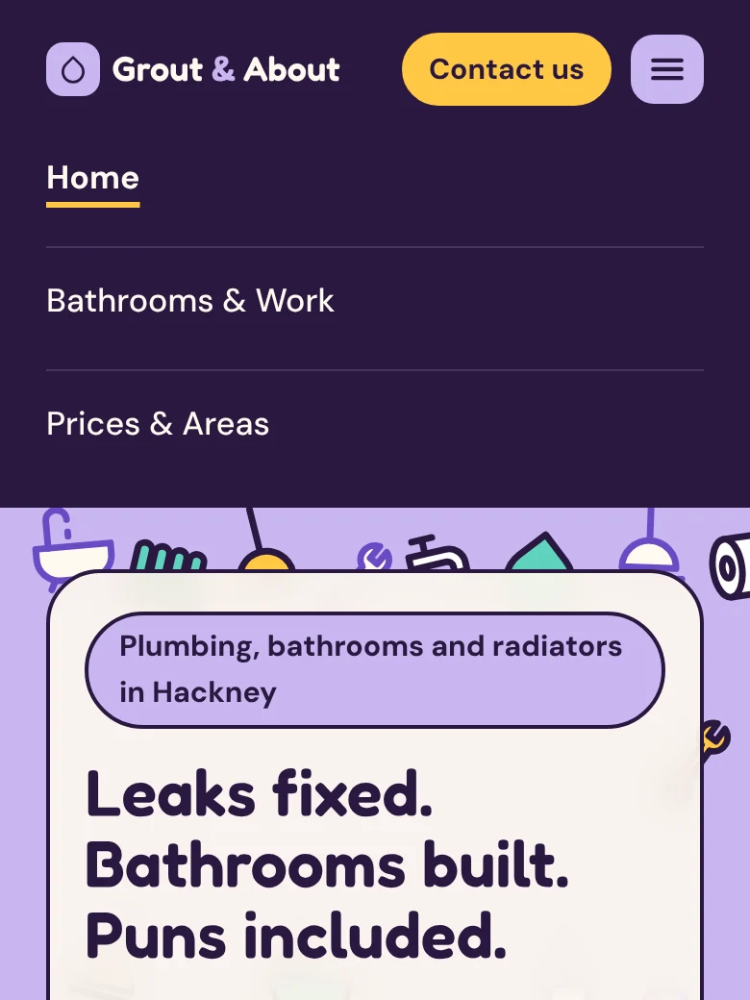

**Hero.** Each page opens with the lilac hero described in [Design devices](#design-devices). On most pages, extra icons appear on very wide screens so the sides never look empty.

**Footer.** The brand and a one-line description, then a single row of links (Home, Bathrooms and Work, Prices and Areas, Contact us, Privacy). The row wraps on small screens instead of stacking into a long list.

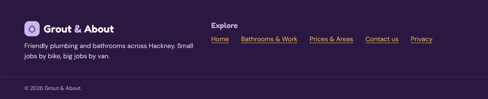

### Home

- **Hero** with the headline, a short introduction, Send an enquiry and See prices buttons, and three ticks: clear prices up front, local to Hackney, small jobs by bike.
- **What we do.** Two lilac panels, "Bathrooms, shower rooms and WCs" and "Radiators", each with three white cards. Every card has a "What's included" drop-down. Only one opens at a time, and opening one doesn't stretch the other cards in its row.
- **Not sure if we can help?** A strip inviting a quick question.
- **Small jobs by bike, big jobs by van.** A mint band linking to the areas covered.
- **Got a drip? Let's get it sorted.** A closing call to action.

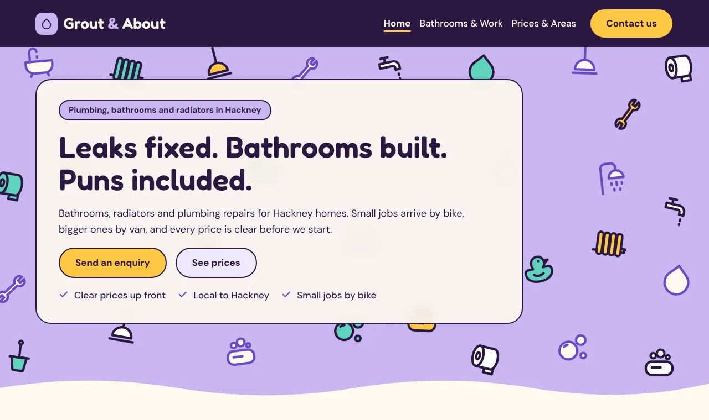

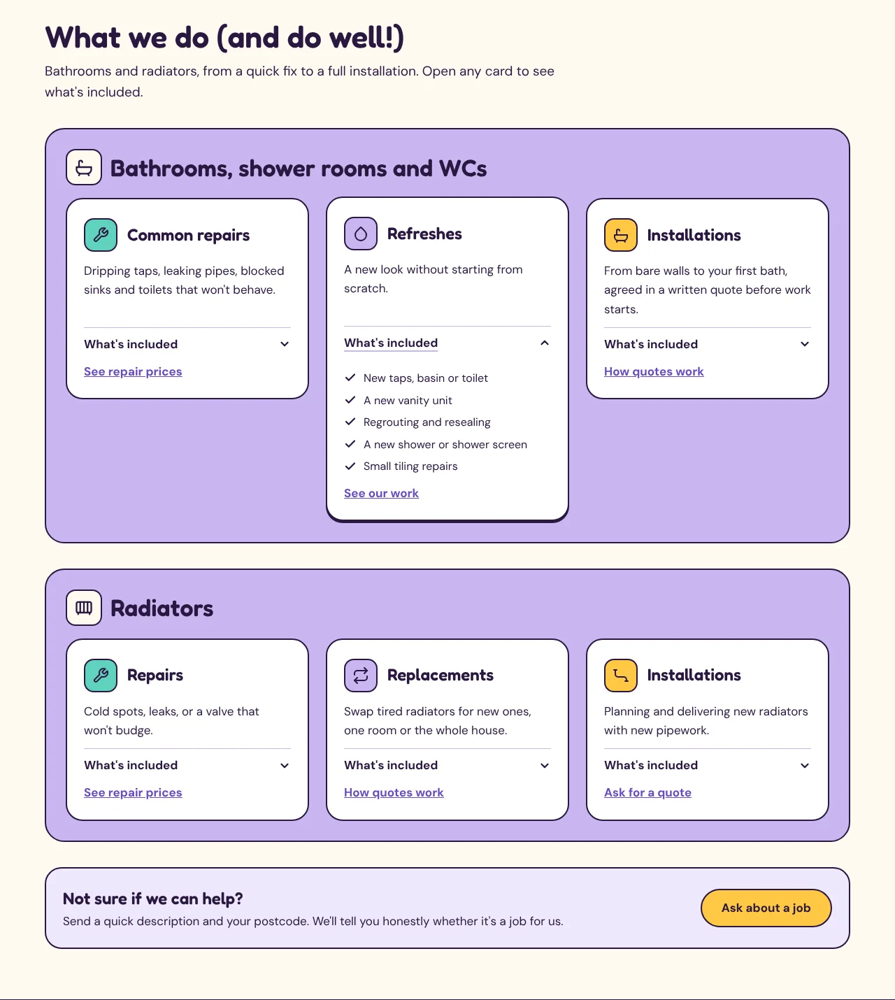

### Bathrooms and Work

- **Hi, I'm John.** A short bio with three chips (bathrooms since 2018, radiators throughout the home, based in Hackney) next to a small carousel holding a headshot, a muted video on the job and a photo of radiator work.
- **Refresh or full install?** Two cards setting out what each option includes. Both are priced by written quote.
- **Recent work.** Three projects, each a Bootstrap carousel of five photos with arrows, dots, a "1 of 5" counter and a caption strip with a status label (Before, In progress or Finished).
- A closing band with an Ask for a quote button.

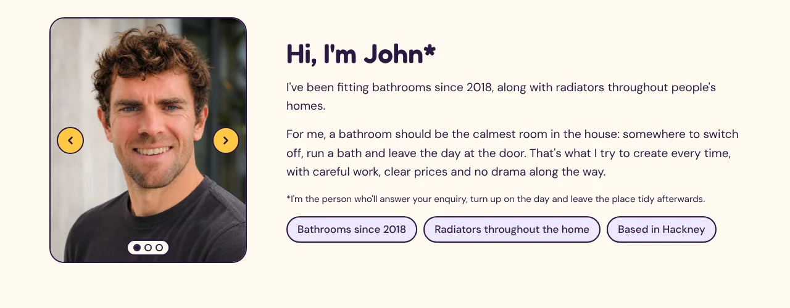

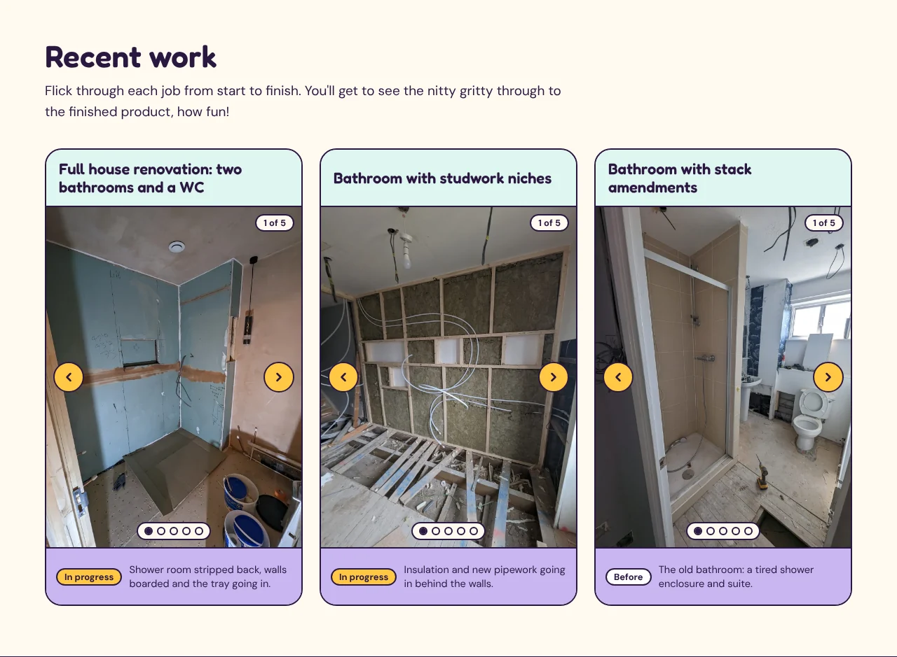

### Prices and Areas

The hero holds two large tab buttons: **Repairs and small jobs** and **Bathroom projects**. They switch between two panels because the two are priced in different ways.

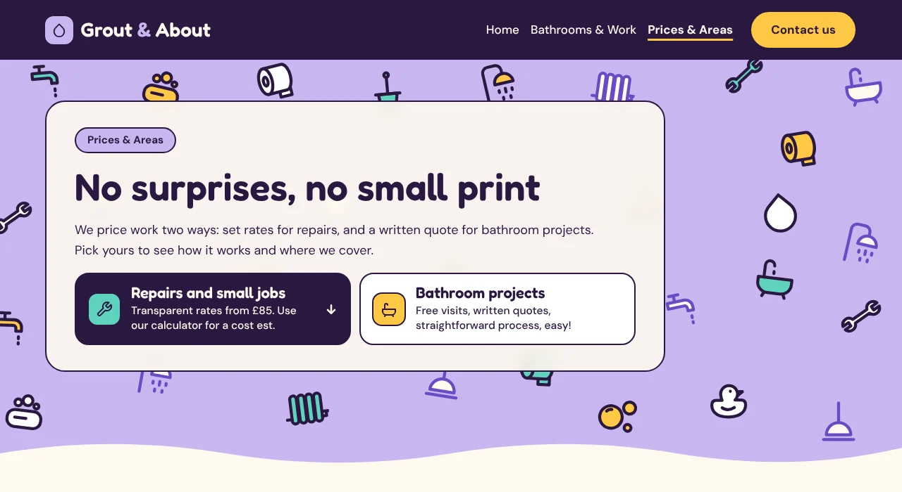

**Repairs and small jobs**

- Three price cards: £85 for the first hour then £40 for each half hour, parts at cost, travel free if you're local.
- **Work out a repair visit.** Pick your area and roughly how long the job will take, and the estimate updates straight away. Check the map opens the map and scrolls to it. Send an enquiry takes the area and time over to the form ([how it works](#calculator-estimate-on-the-form)).
- **How we charge, in full.** A drop-down with every rule in one list, including that VAT is included.
- **Getting around London is pants.** The three travel zones (no fee, £30, £50) and a See the price map button that opens a ward-by-ward map.

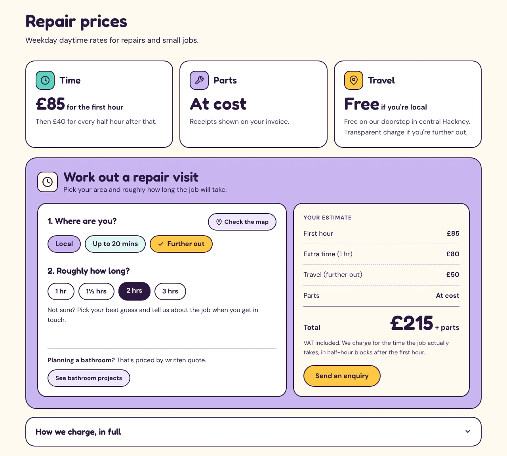

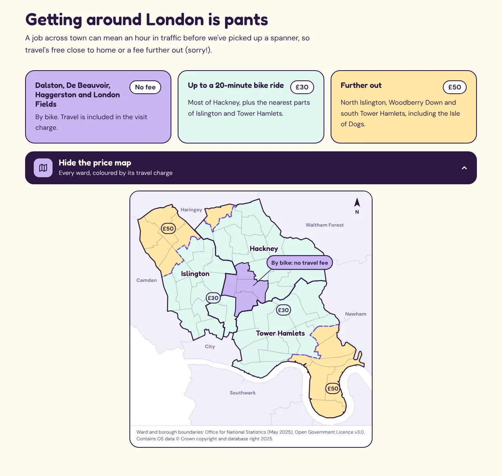

**Bathroom projects**

- **How bathroom projects work.** Six numbered steps from "Tell us about it" to "Finish and sign off".
- **Good to know.** Three buttons (We handle, You handle, Where we'll work) that open one panel at a time.
- A link back to the repair prices tab.

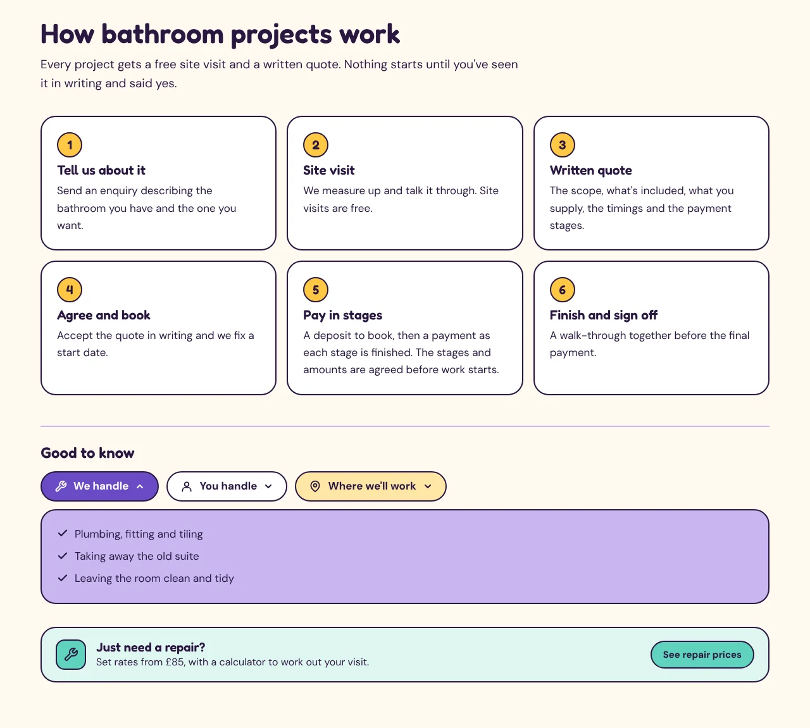

### Contact us

- The form asks for name, email, phone, postcode, job type and job description. Every field has a visible label and is required.
- **A message under each field that needs fixing**, saying why, not just that something's wrong. Each field is checked when you leave it and again when you press Send enquiry. A field with a problem gets a red border and its message, a line under the button says how many fields need fixing, and the first one gets focus. The message clears as soon as the field is right.

  | Field | Checked for | Message when it's wrong |
  |---|---|---|
  | Name | Filled in | Please enter your name. |
  | Email | Something before and after an @, and a full stop after it | That email address isn't complete. It needs an @ and a full stop after it, like name@example.com. |
  | Phone | 7 to 30 characters: numbers, spaces, +, brackets or dashes | Please enter a phone number of at least 7 digits, using only numbers, spaces, +, brackets or dashes, like 07700 900123. |
  | Postcode | A full UK postcode, both parts | Please enter your full postcode, both parts, like E8 4DA. |
  | Job type | One chosen | Please choose the type of job. |
  | Job description | Filled in | Please tell us a little about the job. |

  An empty field, or one with only spaces, gets "Please enter your..." instead. The rules match the Apps Script's own checks, so anything the page accepts, the script accepts too.
- `autocomplete` values let phones fill in name, email, phone and postcode.
- **Photos or videos (optional).** An "Add a photo or video" button adds files one at a time or several at once, up to six. Each file gets its own row with a small preview, a Remove button and a box for a one-line comment, so John knows what he's looking at. Anything over the limits isn't added, and a message says why ([how it works](#photo-and-video-uploads)).
- **The calculator estimate.** Coming from Send an enquiry on the calculator, a mint box above the form says, for example, "Your calculator estimate: £155 + parts (up to 20 mins away, about 1½ hrs of work). We'll confirm it when we reply." The area and time go with the enquiry, and both emails and the PDF show the travel zone, job length and estimate.
- A line under the button explains how the details are used, with a link to the privacy page.
- On a successful send the visitor goes to the thank-you page. If something goes wrong a message appears under the form and the button comes back so they can try again.

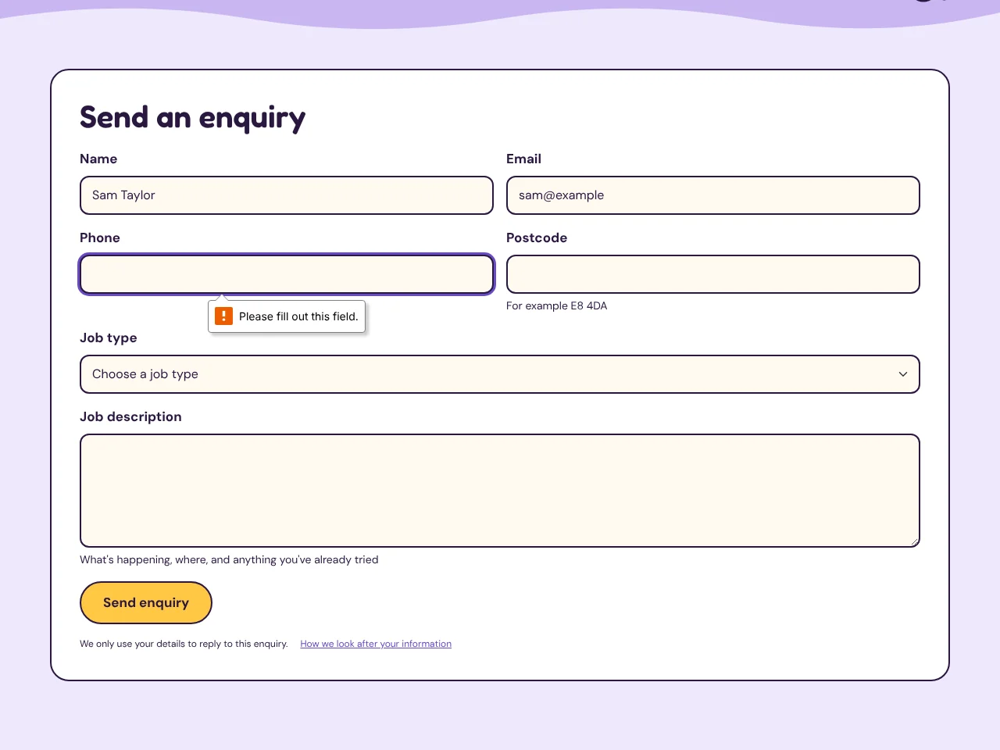

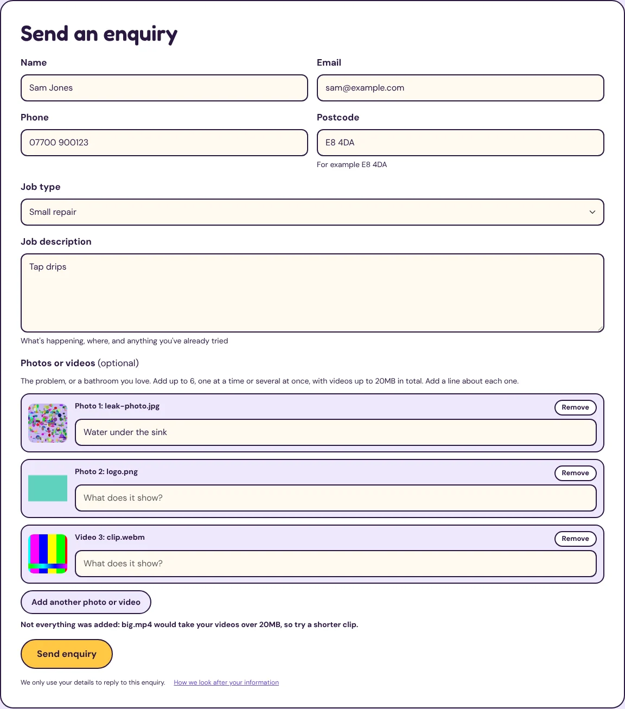

### Thank you page

"Form sent. No drips, no drama." It says replies come within one working day and that an enquiry isn't a confirmed appointment, with Back to home and Send another enquiry buttons.

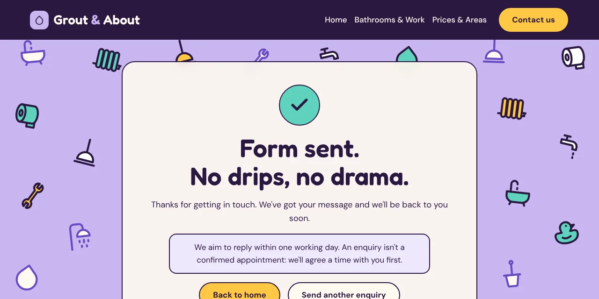

### Privacy page

Because the form collects personal details, the site has a privacy page. Article 13 of the UK GDPR says that when personal data is collected from someone, they must be told at that point who is collecting it, why, how long it's kept, their rights and how to complain ([legislation.gov.uk](https://www.legislation.gov.uk/eur/2016/679/article/13)). The page covers who runs the business, what's collected, why, where it's kept, how long it's kept, your rights and how to complain to the ICO.

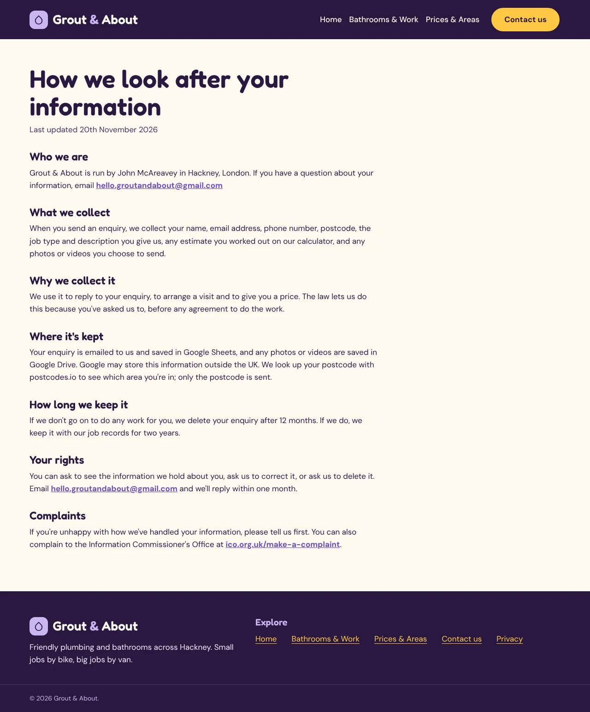

### Future features

- **Check the travel zone against the postcode.** The script already looks up the ward from the postcode, so it could flag an enquiry where someone picked "Local" but lives further out, before a price is agreed.

---

## JavaScript and Google Apps Script

All the site's own JavaScript is in one file, `assets/js/main.js` (434 lines). Each block checks that its page's elements exist before doing anything, so the same file can load on every page.

### Why the form needs JavaScript

The aim is simple: the visitor submits the enquiry, then Google Apps Script emails it to John and to the visitor. A plain HTML form could post straight to the Apps Script address with no JavaScript at all. The catch is that the browser would then leave the site and show Google's raw reply, and a mistake in a field would leave the visitor stuck on that page.

Photos and videos are a second reason. They have to be shrunk and turned into text before they can travel with the rest of the form, and only the browser can do that before sending.

A short script fixes both. It stops the normal submit, sends the fields in the background with `fetch`, and then either goes to `thankyou.html` or shows a message under the form. The browser's own required-field and format checks still run first, because the `submit` event only fires once every field passes.

```js
// The submit event only fires once every field passes the browser's checks
enquiryForm.addEventListener("submit", async (event) => {
  event.preventDefault();
  sendButton.disabled = true; // stops a second press sending it twice
  sendButton.textContent = "Sending…";

  try {
    const data = {};
    for (const [name, value] of new FormData(enquiryForm)) {
      if (typeof value === "string") data[name] = value.trim();
    }

    // Plain text, so the browser sends it straight away with no extra check first
    const response = await fetch(ENQUIRY_URL, {
      method: "POST",
      headers: { "Content-Type": "text/plain;charset=utf-8" },
      body: JSON.stringify(data),
    });
    const result = await response.json();

    if (result.ok) {
      window.location.href = "thankyou.html";
    } else {
      showProblem(result.message);
    }
  } catch (error) {
    showProblem("Sorry, that didn't send. Please try again in a few minutes.");
  }
});
```

**Why `text/plain`?** Sending to another website with a JSON content type makes the browser ask that site for permission first, with a separate "preflight" request. Apps Script web apps only handle `doGet` and `doPost`, so they can't answer it. `text/plain` is one of the content types that skip the preflight ([MDN: simple requests](https://developer.mozilla.org/en-US/docs/Web/HTTP/CORS#simple_requests)), and the script reads the body as JSON anyway.

### What main.js does

| Feature                 | Page               | How it works                                                                                                                                                                                                                                                   |
| ----------------------- | ------------------ | -------------------------------------------------------------------------------------------------------------------------------------------------------------------------------------------------------------------------------------------------------------- |
| Slide counter           | Bathrooms and Work | Listens for Bootstrap's `slide.bs.carousel` event and writes "2 of 5" using `event.to`, the number of the slide that's coming in.                                                                                                                              |
| Carousel preloader      | Bathrooms and Work | An `IntersectionObserver` notices when a carousel is within 300px of the screen, switches its photos from `loading="lazy"` to `eager` and calls `img.decode()`, so every slide is ready before it's shown. See [Challenges](#3-white-blocks-in-the-carousels). |
| Repair visit calculator | Prices and Areas   | Reads the checked area and time on every `change` event. Total = £85 + £40 for each half hour after the first hour + travel (£0, £30 or £50). Updates the line items and the total.                                                                            |
| Estimate on the form    | Prices and Areas, Contact us | The calculator adds the picked area and time to its Send an enquiry link, like `contact.html?area=near&minutes=90`. The Contact us page reads them with `URLSearchParams`, shows the estimate and puts both values in hidden fields. See [Calculator estimate on the form](#calculator-estimate-on-the-form). |
| Check the map           | Prices and Areas   | Opens the map with Bootstrap's Collapse API, waits for the `shown.bs.collapse` event, then scrolls the map into view. If the map is already open it scrolls straight away.                                                                                     |
| Tab shortcuts           | Prices and Areas   | Buttons with a `data-show-tab` attribute (See bathroom projects, See repair prices) switch tabs with `bootstrap.Tab.getOrCreateInstance(tab).show()` and scroll back up to the tabs.                                                                           |
| Photo and video list    | Contact us         | Keeps every file added in an array, so each pick adds to the list instead of replacing it. Skips anything over six files or 20MB of video, then redraws one row per file from a `<template>`, with a preview from `URL.createObjectURL`, a Remove button and the comment typed so far. |
| Field messages          | Contact us         | The form has `novalidate`, so the browser doesn't show its own pop-up. On Send and when a field is left, `field.validity` says whether it passes its `required` and `pattern` rules, and the message comes from the field's `data-missing` or `data-wrong` attribute. The message goes in a `<p>` the field points to with `aria-describedby`, so screen readers read it with the label, and `aria-invalid="true"` turns the border red. |
| Sending the enquiry     | Contact us         | The `async` submit handler above. It disables the button while sending, adds any photos and videos, shows a message from the server if a field is wrong, and catches network failures. |

### Google Apps Script

> **Status on 20 November 2026: live.** The Apps Script is deployed as a web app in the business Google account, and its address is in `ENQUIRY_URL` in `main.js`. It passes 51 automated tests, and a real enquiry sent from the live site with two photos arrived as expected: both emails, the PDF with the photos and their comments, and a Drive folder (see [A real enquiry from the live site](#a-real-enquiry-from-the-live-site)).

Apps Script was chosen because it's free with a Google account, needs no server, and can write to Google Sheets, save to Google Drive and send email from the business's Gmail address.

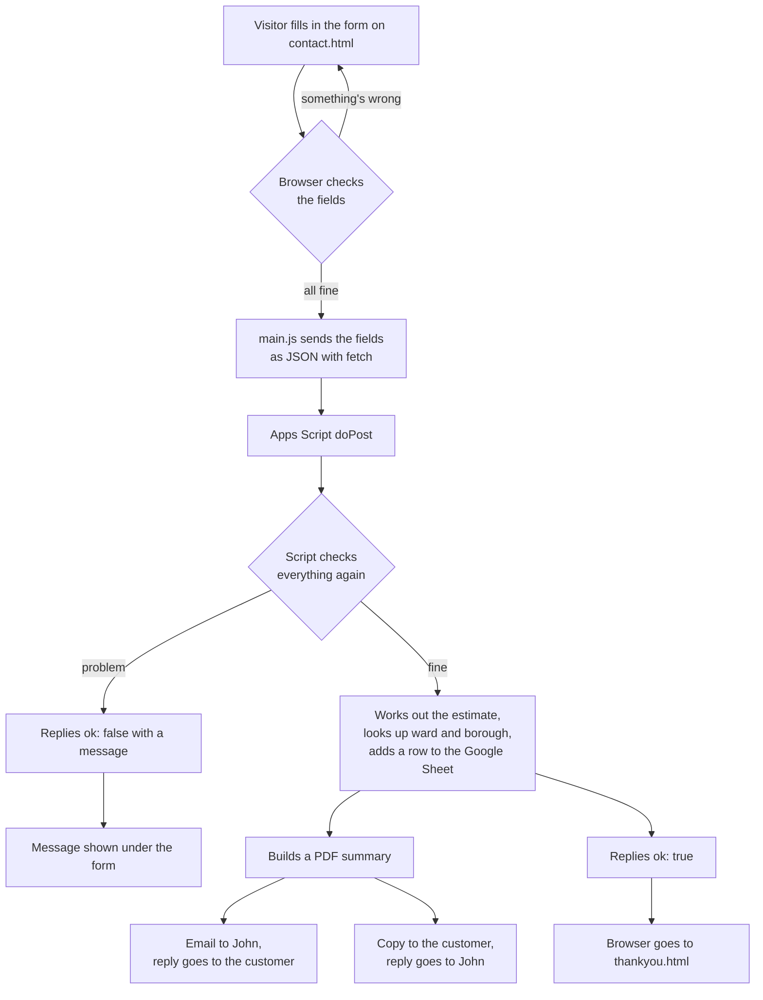

What the script does with each enquiry:

1. **Spots bots.** The form has a hidden field that people never see. If it has anything in it, the script replies "ok" so the bot moves on, but sends and saves nothing.
2. **Checks every field again.** Anyone can post to the script's address without using the form, so it trims each field to a sensible length and checks the email, phone, postcode and job type itself.
3. **Limits repeats.** It counts rows in the Sheet and refuses a fourth enquiry from the same email address within 24 hours.
4. **Works out the estimate itself.** If an area and job length are sent, it recalculates the price with the same rates as the calculator. It never trusts a price sent from the page, because anyone can edit a page.
5. **Looks up the postcode** with [postcodes.io](https://postcodes.io/) to add the ward and borough. If that service is down, it carries on without them.
6. **Gives the enquiry a reference** such as GA-1120-1432 (month, day, hour and minute).
7. **Checks the email allowance.** Each enquiry sends two emails. A free Google account can send to 100 recipients a day from Apps Script ([Google's quota table](https://developers.google.com/apps-script/guides/services/quotas)), so the script checks what's left first. If there's no room it still logs the enquiry with "Not emailed: daily limit reached".
8. **Makes a PDF** of the enquiry from HTML and attaches it to both emails. John's copy replies to the customer, and the customer's copy replies to John.
9. **Replies to the browser** with `{ ok: true }` or `{ ok: false, message }`.

The settings the script needs (the business email address, the Sheet's ID and the uploads folder's ID) are kept in the project's **Script Properties**, not in the code. That keeps them out of the code and means they can change without editing it.

#### What the emails look like

#### A real enquiry from the live site

Sent from the live site on 20 November 2026 with two photos, each with a comment. The sender's name, email, phone, postcode and ward are hidden in these screenshots for privacy.

**John's copy.** The job and area come first, and "2 in Drive" links to the enquiry's own folder. The estimate line says "They didn't use the calculator" because the form didn't carry the calculator estimate over yet. That was added on 21 November ([Calculator estimate on the form](#calculator-estimate-on-the-form)).

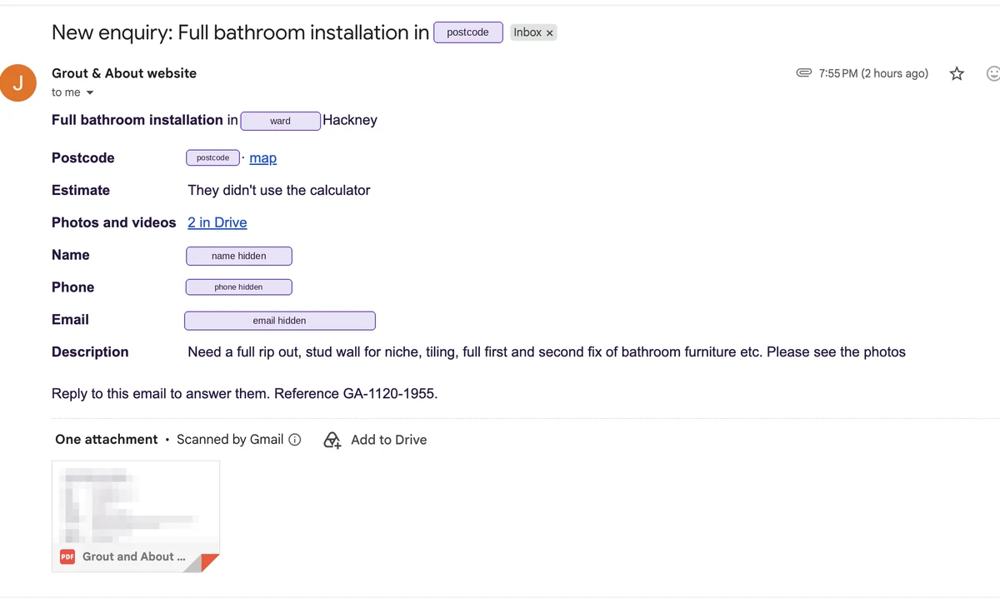

**The PDF** attached to both emails, with each photo and its comment underneath:

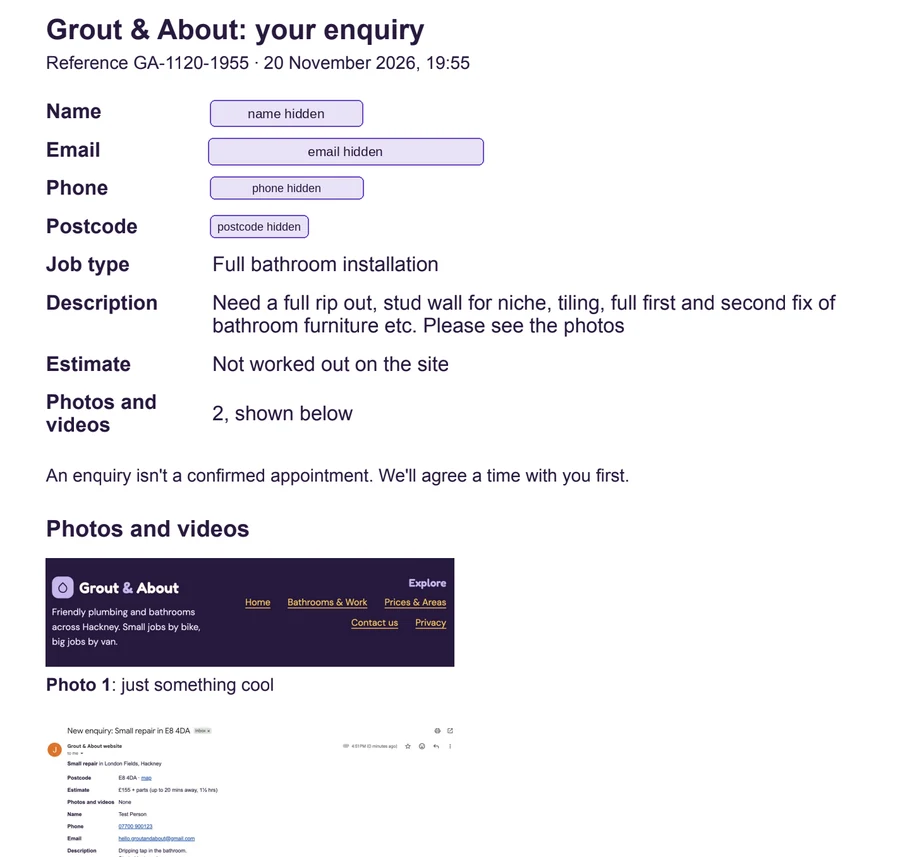

#### From the first test in the Apps Script editor

These are from the first real test on 20 November 2026, run from the Apps Script editor with test details.

**John's copy.** The job and area come first, because that's what he needs to plan the visit. The ward came from the postcode lookup. Pressing Reply answers the customer, because the email's Reply-To is set to their address.

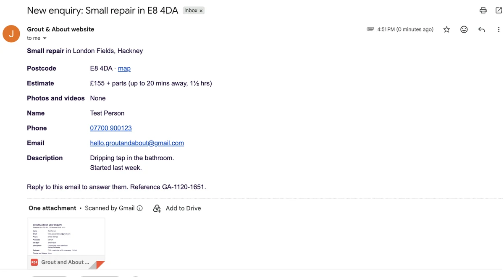

**The customer's copy.** Friendly, in the same voice as the site, with the estimate they worked out and the same PDF for their records. Their replies go to John.

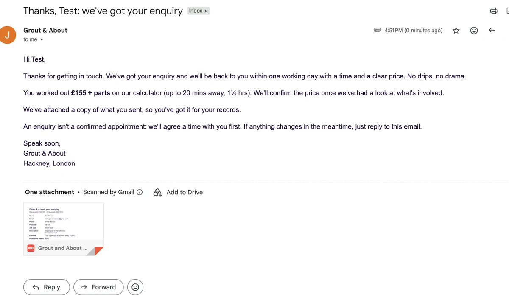

**The PDF** attached to both emails:

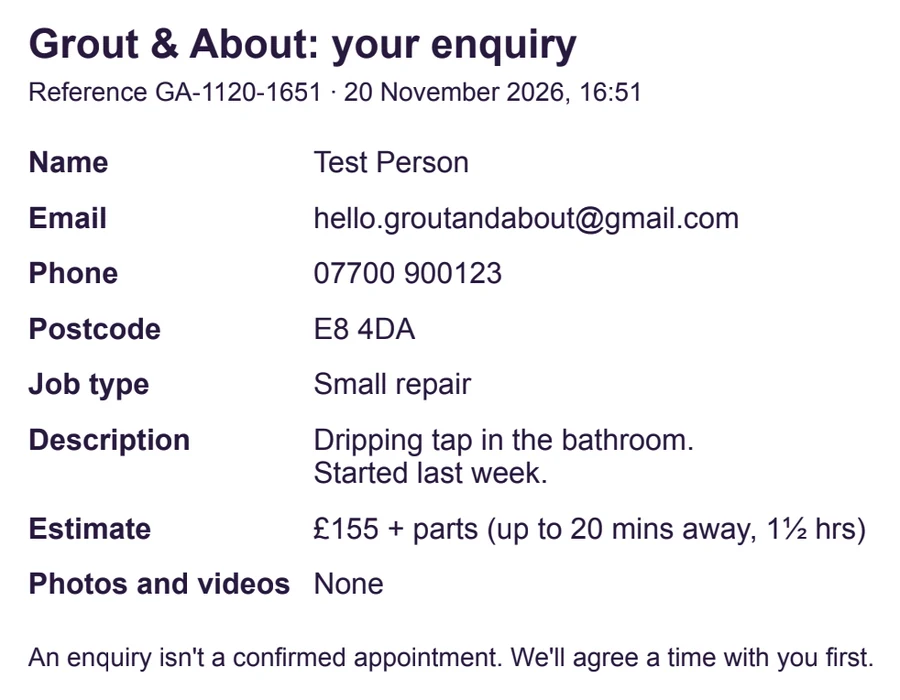

The test function sends a calculator estimate, so it shows in all three. These screenshots show the first layout, with the estimate on one line. Since 21 November it's three rows: travel zone, job length, and the estimate with each part of it (£85 first hour, £40 extra time, £30 travel, parts at cost), the same lines the customer saw on the calculator.

### Calculator estimate on the form

In the first live test from the calculator, the emails said "They didn't use the calculator", because Send an enquiry was a plain link to `contact.html`. Now the area and time picked travel with the link:

1. **On Prices and Areas,** every time an area or time is picked, `updateEstimate()` also rewrites the link, for example to `contact.html?area=far&minutes=180`. The part after `?` is a query string: extra information on the end of an address that the next page can read. Nothing is sent anywhere.
2. **On Contact us,** `new URLSearchParams(window.location.search)` reads `area` and `minutes`. If both are values the calculator could have sent, the page works out the same total, shows it in the mint box and puts both values in hidden `<input type="hidden">` fields, which go with the form like any other field.
3. **In the script,** `workOutEstimate_` works the price out again with its own copy of the rates. The page only ever shows the estimate. Anyone can edit an address, so a price sent from the page is never trusted.

Only the area and time are sent, not the price, because those are what the owner needs to plan the visit, and the price follows from them.

**Checking the values.** The first version checked `areas[area]`. That is also true for names every JavaScript object has, like `toString` or `__proto__`, so an edited address such as `?area=toString&minutes=constructor` showed a broken estimate. Both `main.js` and the script now check the value is one of the keys they wrote: `Object.keys(areas).includes(area)`. The same fix stops `__proto__` getting past the job type check in the script.

### Photo and video uploads

A photo of a leak or a tired bathroom tells John far more than a description, so the form takes up to six photos or videos, each with a one-line comment (up to 100 characters).

- **Added one at a time, or several at once.** A file box normally replaces its files each time you pick, so the script keeps its own list. Each pick is added to the list, the box is emptied (so the same file can be added again), and the rows are redrawn. Comments typed so far are kept, and Remove takes a file back out.
- **Checked as they're added.** A seventh file, or a video that would take the total over 20MB, isn't added, and a message under the button says why. At six files the button turns off and reads "6 files added".
- **Keyboard friendly.** The real file box is hidden with Bootstrap's `visually-hidden` class but can still be reached with Tab. Its pill-shaped label shows the focus outline (`.media-input:focus-visible + .add-media`). After a Remove, focus moves back to the Add button, so keyboard users aren't left on a button that no longer exists.
- **Photos are shrunk in the browser** before sending: drawn onto a canvas no more than 1600px on the longest side and saved as a JPEG at 75% quality. A white background is painted first, so transparent PNGs don't turn black. In testing, a 1MB photo went out as 148KB.
- **Videos can't play in a PDF,** so the browser takes a still frame from one second in (or halfway through a very short clip) for the PDF. The video itself is sent as it is and saved to Drive.
- **A photo the browser can't open** (for example an iPhone HEIC photo in Chrome) stops the send with a message asking for a JPEG or PNG, instead of failing silently.
- Everything travels as base64 text in the same JSON request. The script only accepts image and video types and plain base64 characters, and refuses more than 25MB in total.
- Each enquiry's files go in their own Drive folder, with the comment saved as each file's description. The PDF shows each photo or still with its comment, and John's email links to the folder.

```js
// Draws a picture smaller on a canvas and returns it as a JPEG, in base64 text
function drawSmaller(picture, width, height) {
  const scale = Math.min(1, PHOTO_SIZE / Math.max(width, height));
  const canvas = document.createElement("canvas");
  canvas.width = Math.round(width * scale);
  canvas.height = Math.round(height * scale);

  const context = canvas.getContext("2d");
  context.fillStyle = "#ffffff"; // JPEGs can't be see-through, so start with white
  context.fillRect(0, 0, canvas.width, canvas.height);
  context.drawImage(picture, 0, 0, canvas.width, canvas.height);
  return canvas.toDataURL("image/jpeg", 0.75).split(",")[1];
}
```

The same function makes the video stills, by passing it the `<video>` element once it has jumped to the right moment.

---

## Changed mid-flight, and why

| What the plan said                                                                                                                    | What was built                                                                                                                   | Why                                                                                                                                                                                            |
| ------------------------------------------------------------------------------------------------------------------------------------- | -------------------------------------------------------------------------------------------------------------------------------- | ---------------------------------------------------------------------------------------------------------------------------------------------------------------------------------------------- |
| Three pages: Home, Services and Contact (the first README)                                                                            | Six pages: Home, Bathrooms and Work, Prices and Areas, Contact us, Thank you and Privacy                                         | The user stories needed more room than one services page: real project photos, a price calculator and an area map. The privacy page became necessary once the form collected personal details. |
| "The form is front-end only for this project, so no message is actually sent" (Issue 4)                                               | The form sends each enquiry to Google Apps Script, which logs it and emails it to both sides (being set up)                      | A form that sends nothing is no use to a real business. John wanted enquiries in his inbox and a copy for the customer.                                                                        |
| A "Rather talk?" box beside the form with phone, email, hours and area (Issue 4), and a "Get in touch" column in the footer (Issue 1) | Both removed. The enquiry form is the only way in                                                                                | One route in means every enquiry arrives with the same details, in the same place, ready to price.                                                                                             |
| Success page called `enquiry-sent.html` (Issues 1 and 4)                                                                              | `thankyou.html`                                                                                                                  | The page was built under that name, so the redirect, links and build guide were updated to match.                                                                                              |
| Prices in a Bootstrap table (Issue 3)                                                                                                 | Price cards, a repair visit calculator, a "How we charge, in full" drop-down, and repairs and bathroom projects on separate tabs | Visitors can work out their own visit instead of reading across a table, and the two ways of pricing (set rates and written quotes) don't get mixed up.                                        |
| Font Awesome icons (the first README)                                                                                                 | Custom SVG icons in the brand colours                                                                                            | Issue 2 asks for icons filled in white, gold, mint or cream so the lilac doesn't show through. The free Font Awesome icons are a single colour.                                                |
| A three-column footer with stacked links and "Demo site for a WAES course project"                                                    | The brand plus one left-aligned row of links, with Privacy added                                                                 | The stacked links made the footer very tall on phones. The privacy page needed linking from every page.                                                                                        |
| No uploads | Photo and video uploads on the enquiry form, each with a one-line comment | So John can see the job before he visits or prices it. |

---

## Challenges overcome

### 1. The wave on the Contact page was the wrong colour

**Problem.** The hero's wavy edge showed a cream strip above the lilac enquiry section instead of blending into it.

**Why.** The wave is cut with a CSS `mask`. The parts that are masked away become see-through, so they show whatever is behind the hero. Behind it was the cream page background, because the enquiry section only started below the hero.

**Fix.** Pull the enquiry section up 48px so it sits behind the bottom of the hero, and give it enough padding that the form still clears the wave. The hero has `position: relative`, so it's drawn on top, and the see-through wave now shows the section's own lilac tint.

```css
.enquiry-section {
  background-color: var(--lilac-tint);
  margin-top: -48px; /* slide up behind the wave */
  padding: 88px 0; /* keeps the form clear of the wave */
}
```

| Before                                                                   | After                                                                               |
| ------------------------------------------------------------------------ | ----------------------------------------------------------------------------------- |
| 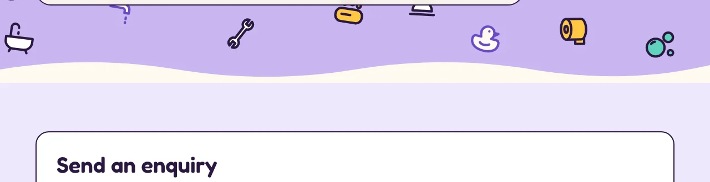 | 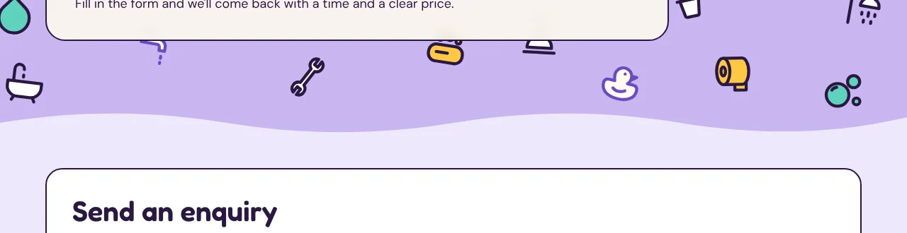 |

### 2. The thank-you page icons were bunched up on the right

**Problem.** On the thank-you page the floating icons crowded the right-hand side and left big gaps on the left.

**Why.** Each icon was placed with a `left` percentage, using positions that suited the other pages, where the hero card sits to the left. On the thank-you page the card is centred, so most icons ended up on one side.

**Fix.** The icon layer was rebuilt in zones: a row along the top, two staggered columns on each side of the card and a row along the bottom. Icons on the right use `right` instead of `left`, so they mirror the left side at any screen width. Extra icons only appear on very wide screens (from 1800px and 2240px), using `.wide-only` and `.extra-wide-only` classes.

| Before                                                                    | After                                                                           |
| ------------------------------------------------------------------------- | ------------------------------------------------------------------------------- |
| 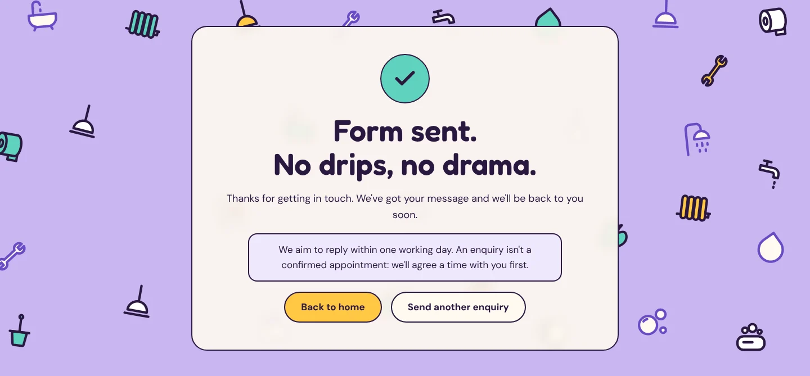 | 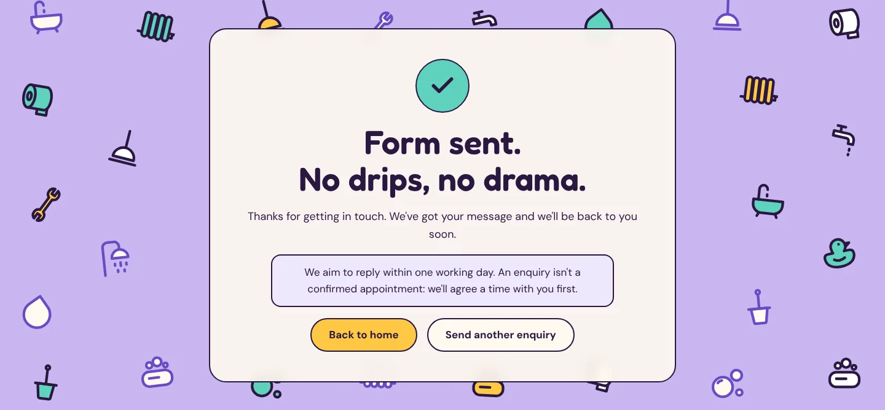 |

### 3. White blocks in the carousels

**Problem.** Clicking to the next photo in a carousel often showed a white block for a moment. Once every photo had been seen once, the carousels worked perfectly.

**Why.** The photos use `loading="lazy"`, which tells the browser to wait until an image is about to be seen. Bootstrap hides every slide except the current one with `display: none`, and the browser treats a hidden image as never about to be seen. So each photo only started downloading as it slid in.

**Fix.** A small `IntersectionObserver` in `main.js` watches each carousel. When one comes within 300px of the screen, it switches that carousel's photos to `loading="eager"` and calls `img.decode()`. The page still doesn't download photos far down the page on load, but each carousel is ready before anyone clicks.

On a test connection throttled to 1.5 Mbps, 1 of the 5 photos in the first project was ready before the first click without the fix, and all 5 with it.

| Before (mid-slide, photo not loaded)                                              | After (mid-slide, photo ready)                                                          |
| --------------------------------------------------------------------------------- | --------------------------------------------------------------------------------------- |
| 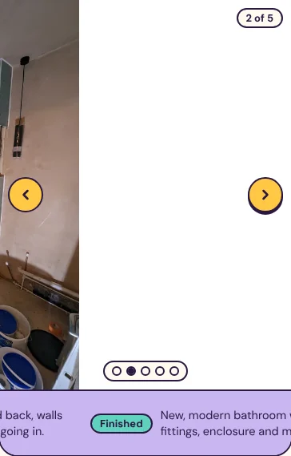 | 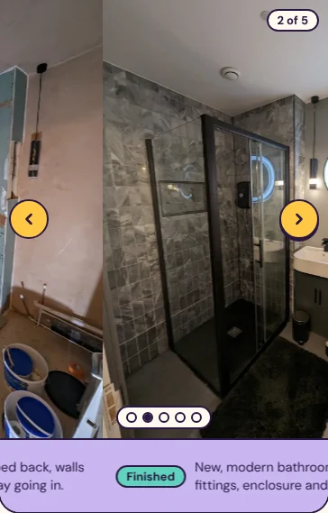 |

### 4. Check the map stopped short

**Problem.** The Check the map button opens the price map and scrolls to it. At first the scroll stopped partway down the page.

**Why.** The map opens with an animation, so for a moment the page is still short. Scrolling straight away aimed at a point the page couldn't reach yet, so the scroll stopped at the bottom of the shorter page.

**Fix.** Wait for Bootstrap's `shown.bs.collapse` event, which fires once the map is fully open, then scroll. `{ once: true }` removes the listener after it runs, so it doesn't pile up on repeat clicks.

```js
priceMap.addEventListener("shown.bs.collapse", scrollToMap, { once: true });
bootstrap.Collapse.getOrCreateInstance(priceMap, { toggle: false }).show();
```

### 5. A very tall footer on phones

**Problem.** With three columns and stacked links, the footer took up most of a phone screen.

**Fix.** The contact column went (see [Changed mid-flight](#changed-mid-flight-and-why)) and the links became one row with flexbox. `flex-wrap: wrap` lets them flow onto a second line on narrow screens, and `gap: 10px 32px` keeps even spacing without margins on each link.

```css
.footer-list {
  margin: 0;
  display: flex;
  flex-wrap: wrap;
  gap: 10px 32px; /* 10px between rows, 32px between links */
}
```

| Before                                                              | After                                                                     |
| ------------------------------------------------------------------- | ------------------------------------------------------------------------- |
| 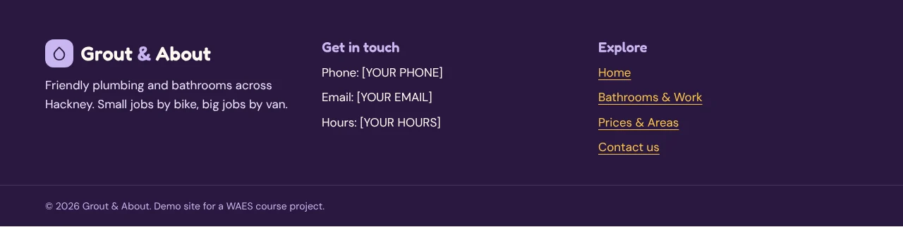 | 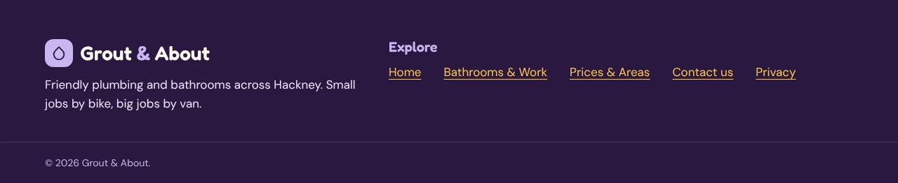 |

---

## Accessibility

- A "Skip to main content" link is the first Tab stop on every page. It waits above the top of the screen (`transform: translateY(-200%)`, so it can still take focus, unlike `display: none`) and slides down over the header when focused, with a cream outline that shows against the plum. Enter jumps to `<main id="main">`, past the logo and menu.
- Semantic landmarks on every page (`header`, `nav`, `main`, `section`, `footer`), one `h1` per page and headings in order.
- `lang="en"` on every page.
- Every image has an `alt` attribute. The 17 project and headshot photos have descriptions, and decorative icons have an empty `alt` and `aria-hidden="true"`.
- Every image has `width` and `height`, so the page doesn't jump as photos load.
- Every form field has a visible label. Email and phone use the `email` and `tel` input types, and name, email, phone and postcode have `autocomplete` values.
- The maps are inline SVGs with `role="img"` and a `<title>`, and the zone cards next to them give the same information as text.
- Each carousel is a labelled region (`role="region"` and `aria-roledescription="carousel"`), and every carousel dot has a label saying which photo it shows.
- Visible focus outlines: violet on light backgrounds, marigold in the plum header and footer, and cream on the skip link.
- The floating icons and button lifts switch off for anyone who has turned on reduced motion (`prefers-reduced-motion`).
- The video is muted and has controls.
- Colour contrast meets WCAG AA for every text pairing used (see [Colour palette](#colour-palette)).

---

## Testing

Full results are in [TESTING.md](TESTING.md). In summary:

- **HTML:** no errors or warnings on any of the six pages (W3C Nu Html Checker). The first run found six warnings, all now fixed.
- **CSS:** the only reports are for newer CSS features the W3C CSS checker doesn't recognise yet, such as `:has()`, `lh` units and `backdrop-filter`.
- **Accessibility:** no axe-core violations on any page at desktop or phone width.
- **Lighthouse:** Accessibility 96 to 100, and Best Practices and SEO 100 on every page.
- **Responsive:** no sideways scrolling on any page at 390px, 820px or 1440px.
- **JavaScript:** all 12 calculator combinations give the right total, and the counter, tabs, map button and form were tested by hand and with automated browser tests.
- **Apps Script:** 51 automated tests pass against stand-in Google services, and a real enquiry from the live site delivered both emails, the PDF with photos, and a Drive folder.
- **JavaScript style:** JSHint reports no warnings.
- **Uploads:** the six-file and 20MB limits, photo shrinking, video stills and the message for a photo the browser can't open were all tested with a stand-in for Google.

---

## Deployment and local development

### GitHub Pages

The site is deployed with GitHub Pages from the `main` branch.

1. In the repository, go to **Settings**, then **Pages**.
2. Under **Build and deployment**, set the source to **Deploy from a branch**.
3. Choose the `main` branch and the `/ (root)` folder, then **Save**.
4. After a minute or two the site is live at `https://code-mca.github.io/grout-and-about/`. Every push to `main` updates it.

### Apps Script (once set up)

1. Create a Google Sheet with an "Enquiries" tab and a Drive folder for uploads.
2. In the Sheet, open **Extensions**, then **Apps Script**, and paste in the script.
3. In **Project Settings**, add Script Properties for `SHEET_ID`, `UPLOAD_FOLDER_ID` and `BUSINESS_EMAIL`.
4. Run `testEnquiry` once from the editor to grant permissions and check both emails arrive.
5. **Deploy**, then **New deployment**, type **Web app**, execute as **Me**, access **Anyone**.
6. Copy the web app URL into `ENQUIRY_URL` in `assets/js/main.js`.

### Fork the repository

1. On GitHub, open [code-mca/grout-and-about](https://github.com/code-mca/grout-and-about).
2. Click **Fork** at the top right to make your own copy.

### Clone and run locally

```bash
git clone https://github.com/code-mca/grout-and-about.git
cd grout-and-about
python3 -m http.server 8000
```

Then open `http://localhost:8000`. Use a local server rather than opening the files directly: the hero wave is a CSS mask image, and Chrome won't load mask images on `file://` pages (found during testing).

---

## Technologies used

**Languages**

- HTML5
- CSS3
- JavaScript (ES2017 and later: `async`/`await`, `fetch`, template literals)
- Google Apps Script (JavaScript run on Google's servers)

**Frameworks, libraries and services**

- [Bootstrap 5.3.8](https://getbootstrap.com/docs/5.3/) from the jsDelivr CDN: grid, navbar, collapse, carousel and tabs
- [Google Fonts](https://fonts.google.com/): Fredoka and DM Sans
- Google Sheets, Google Drive and Gmail through Apps Script
- [postcodes.io](https://postcodes.io/) for ward and borough lookups

**Tools**

- Visual Studio Code
- Git and GitHub, with GitHub Issues for user stories and GitHub Pages for hosting
- Chrome DevTools
- W3C Nu Html Checker and CSS checker, axe-core and Lighthouse for testing
- Claude (Anthropic), see [AI assistance](#ai-assistance)

---

## Credits

### Code

- [Bootstrap 5.3 documentation](https://getbootstrap.com/docs/5.3/) for the navbar, collapse, carousel and tab components and their events.
- [MDN Web Docs](https://developer.mozilla.org/) for `IntersectionObserver`, `fetch`, `FormData`, CSS masks and CORS.
- [Google Apps Script documentation](https://developers.google.com/apps-script) for web apps, `MailApp`, `DriveApp` and quotas.

### Content

- All text was written by the owner of Grout & About.
- The privacy page follows the information list in [Article 13 of the UK GDPR](https://www.legislation.gov.uk/eur/2016/679/article/13).

### Media

- All project photos, the headshot and the video are John's own.
- Map boundaries: Office for National Statistics (May 2025), Open Government Licence v3.0. Contains OS data © Crown copyright and database right 2025.
- Several UI icons (for example the wrench, map pin, clock and swap arrows) use shapes from [Feather Icons](https://feathericons.com/) by Cole Bemis (MIT licence), recoloured to plum.

### AI assistance

Claude (Anthropic) was used as a tutor and pair programmer on this project. It helped draft the user stories, wrote a step-by-step build guide that John used to build the sections of the website over the course of a week, suggested and in places applied code changes, drew custom icons, wave and maps (these SVG files carry Claude content credentials), and produced the screenshots and automated tests for this README and TESTING.md.
