# Grout & About: Testing

[Back to the README](README.md)

All tests below were run on 20 November 2026 against the files in this repository, served from a local web server. Browser tests used Chrome for Testing 153 driven by Playwright 1.63.

## Contents

- [Code validation](#code-validation)
- [Accessibility](#accessibility)
- [Lighthouse](#lighthouse)
- [Responsiveness](#responsiveness)
- [Browser compatibility](#browser-compatibility)
- [User story testing](#user-story-testing)
- [JavaScript feature testing](#javascript-feature-testing)
- [Apps Script testing](#apps-script-testing)
- [Bugs](#bugs)

---

## Code validation

### HTML

Checked with the Nu Html Checker (vnu.jar version 20.6.30), the same checker that runs [validator.w3.org/nu](https://validator.w3.org/nu/).

| Page | Errors | Warnings |
|---|---|---|
| index.html | 0 | 0 |
| bathrooms.html | 0 | 0 |
| prices.html | 0 | 0 |
| contact.html | 0 | 0 |
| thankyou.html | 0 | 0 |
| privacy.html | 0 | 0 |

The first run found no errors but six warnings, all now fixed:

- Four carousels had an `aria-label` on a plain `div` with no role. They now have `role="region"` and `aria-roledescription="carousel"`.
- The list of rate cards on Prices and Areas had an `aria-label` on a `ul`. The section heading already names it, so the label was removed.
- A comment on Bathrooms and Work ended in `--->` instead of `-->`.

### CSS

Checked `assets/css/styles.css` with the W3C CSS checker built into the same tool. It reported 22 items, all for newer CSS that the checker doesn't recognise yet. Each one displays as intended in Chrome.

| What it reported | Lines | What the code does |
|---|---|---|
| Parse error on the `:has()` selector (4) | 559, 1193, 1637, 1651 | Styles a card when something inside it has keyboard focus, and a drop-down when its summary is hovered |
| `lh` unit in `min-height` (4) | 1666, 1673, 1680, 1690 | Gives service card descriptions a height of 2 or 3 lines so closed cards line up |
| `text-underline-offset` (3) | 156, 214, 532 | Moves link underlines slightly down from the text |
| `transform` using `var()` inside `rotate()` and `calc()` (3) | 272, 296, 299 | Tilts each floating icon by its own angle as it bobs |
| `mask` and `-webkit-mask` (3) | 250, 253, 1107 | Cuts the wavy bottom edge of the hero, and draws the tick on a chosen calculator option |
| `text-decoration-thickness` (2) | 155, 531 | Sets the thickness of link underlines |
| `top` and `bottom` using `calc()` with `var()` (2) | 847, 851 | Positions the carousel arrows and dots above the caption strip |
| `backdrop-filter` (1) | 315 | Blurs the icons behind the frosted hero card |

### JavaScript

`assets/js/main.js` was checked with JSHint 2.13.6 (settings: `esversion: 11`, `browser: true`, `undef: true`, `unused: true`, with `bootstrap` as a known global). It reports no warnings. The first two settings are also at the top of `main.js` as comments, so pasting the file into [jshint.com](https://jshint.com/) gives the same result.

The first run gave six style warnings, now fixed. Three functions were declared inside `if` blocks, and are now written as `const` arrow functions. Three ternaries were split over lines before the `?`, and now each label is worked out on one short line first.

The browser console showed no JavaScript errors on any page.

---

## Accessibility

### axe-core

Each page was scanned with axe-core 4.14 against WCAG 2.0 and 2.1 A and AA plus axe's best-practice rules, at 1440px and 390px wide.

| Page | Violations at 1440px | Violations at 390px | Rules passed |
|---|---|---|---|
| Home | 0 | 0 | 36 |
| Bathrooms and Work | 0 | 0 | 40 |
| Prices and Areas | 0 | 0 | 49 |
| Contact us | 0 | 0 | 39 |
| Thank you | 0 | 0 | 31 to 33 |
| Privacy | 0 | 0 | 32 to 34 |

Last run on 21 November 2026, after the skip link and the calculator estimate box were added. Contact us shows fewer rules passed than the first run because the upload field changed from a visible file box to a hidden one with a label.

axe also lists items it can't decide on its own:

- **Colour contrast "needs review"** on text that sits over the frosted hero card or the tick-list icons, because axe can't work out a background colour from a blurred or image background. That text is plum on cream, white or lilac, which is 8.7:1 or higher (see the [README contrast table](README.md#colour-palette)).

### Keyboard

Every page was tabbed through from top to bottom with the keyboard at 1280px and 390px. Every tab stop showed a visible focus outline. The first stop on every page is the skip link.

| Page | Tab stops at 1280px | Tab stops at 390px | Stops with no visible focus |
|---|---|---|---|
| Home | 28 | 26 | 0 |
| Bathrooms and Work | 38 | 36 | 0 |
| Prices and Areas | 21 | 19 | 0 |
| Contact us | 20 | 18 | 0 |
| Thank you | 13 | 11 | 0 |
| Privacy | 14 | 12 | 0 |

**Skip link.** Tested in Chromium on all six pages at 1280px and 390px (36 checks, all pass): the link is off screen before any key is pressed, the first Tab brings it into view on top of the header with a cream outline, and Enter then Tab lands on the first link or button inside `<main>`.

On phones there are two fewer stops because the three page links sit inside the closed burger menu. The calculator's area and time choices are radio groups, so each group is one tab stop and the arrow keys move between options.

### Images

- 242 images across the six pages. All have an `alt` attribute and all have `width` and `height`.
- 17 photos have descriptive alt text. The rest are decorative icons with `alt=""` and `aria-hidden="true"`.

---

## Lighthouse

Lighthouse 12 was run on each page in its mobile and desktop modes.

> **Read these as a guide, not final scores.** They were run against a local copy where Bootstrap and the fonts were served from the same machine, because the test machine can't reach those outside sites. Performance in particular will be different on the live site. Re-run Lighthouse on the live site from Chrome DevTools before submitting.

| Page | Mode | Performance | Accessibility | Best Practices | SEO |
|---|---|---|---|---|---|
| Home | Mobile | 77 | 100 | 100 | 100 |
| Home | Desktop | 98 | 100 | 100 | 100 |
| Bathrooms and Work | Mobile | 72 | 96 | 100 | 100 |
| Bathrooms and Work | Desktop | 98 | 96 | 100 | 100 |
| Prices and Areas | Mobile | 72 | 100 | 100 | 100 |
| Prices and Areas | Desktop | 96 | 100 | 100 | 100 |
| Contact us | Mobile | 80 | 100 | 100 | 100 |
| Contact us | Desktop | 98 | 100 | 100 | 100 |
| Thank you | Mobile | 78 | 100 | 100 | 100 |
| Thank you | Desktop | 99 | 100 | 100 | 100 |
| Privacy | Mobile | 90 | 100 | 100 | 100 |
| Privacy | Desktop | 100 | 100 | 100 | 100 |

The first run scored 96 for Best Practices and 90 or 91 for SEO on every page, because there was no favicon and no page had a meta description. Both are now added.

Where points are still lost:

- **Accessibility (Bathrooms and Work only):** the carousel dots are smaller than Lighthouse's recommended touch target size.
- **Performance (mobile):** the Bootstrap stylesheet blocks the first paint, and most of its rules aren't used. Lighthouse estimated about 1.6 seconds could be saved on its simulated slow phone connection. Cumulative Layout Shift was 0 on every page, because every image has a width and height.

---

## Responsiveness

Each page was loaded at three widths and checked for sideways scrolling (page width minus window width).

| Page | 390px (phone) | 820px (tablet) | 1440px (desktop) |
|---|---|---|---|
| Home | No overflow | No overflow | No overflow |
| Bathrooms and Work | No overflow | No overflow | No overflow |
| Prices and Areas | No overflow | No overflow | No overflow |
| Contact us | No overflow | No overflow | No overflow |
| Thank you | No overflow | No overflow | No overflow |
| Privacy | No overflow | No overflow | No overflow |

Below are the top of each page at each width.

| Page | Phone (390px) | Tablet (820px) | Desktop (1440px) |
|---|---|---|---|
| Home | 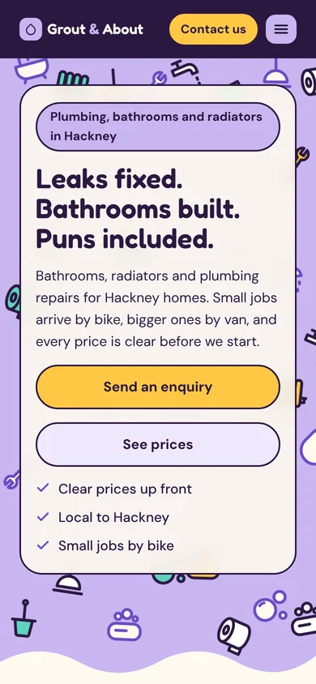 | 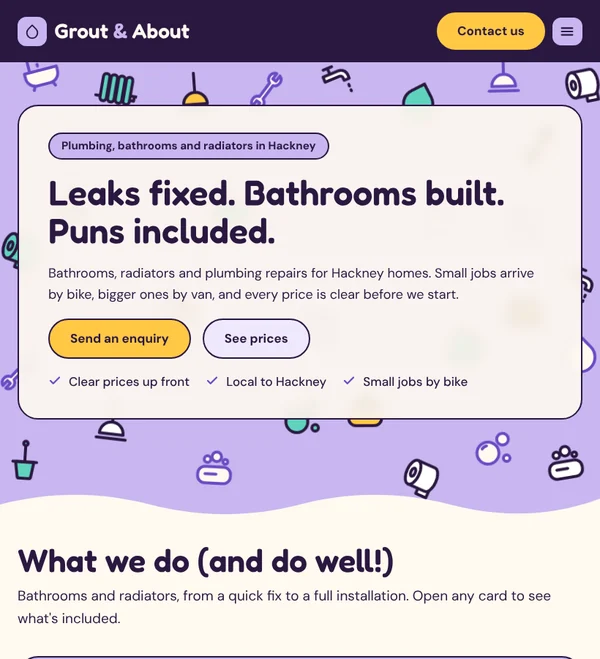 | 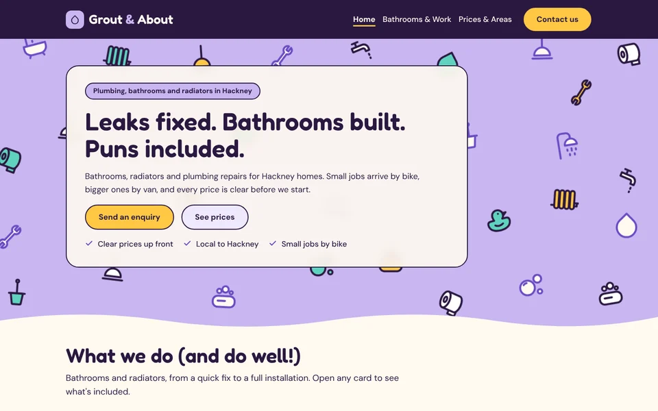 |
| Bathrooms and Work | 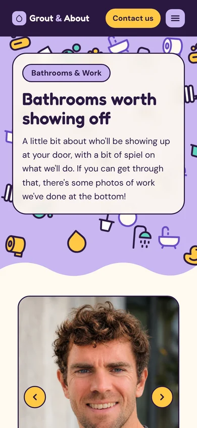 | 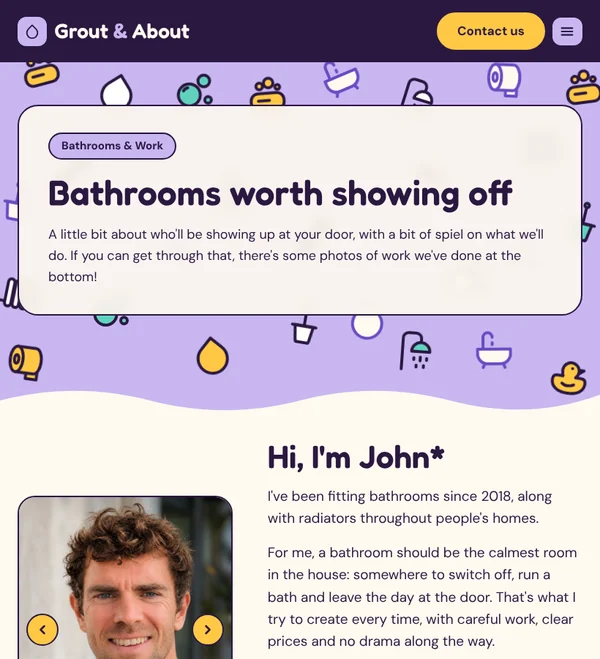 | 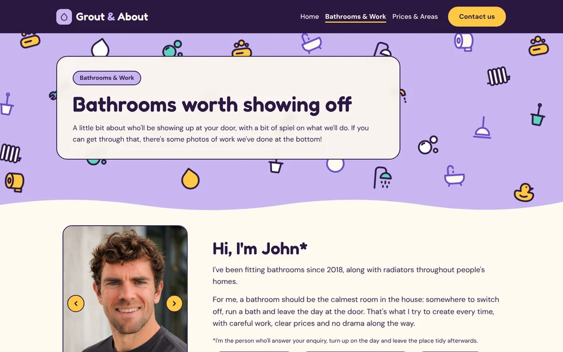 |
| Prices and Areas | 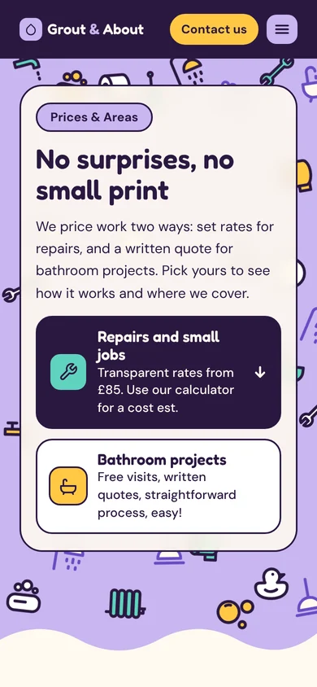 | 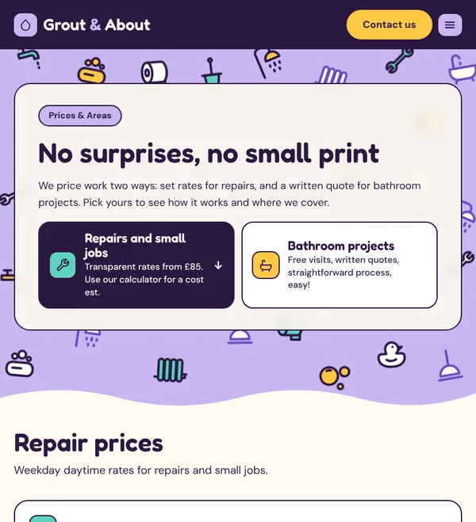 | 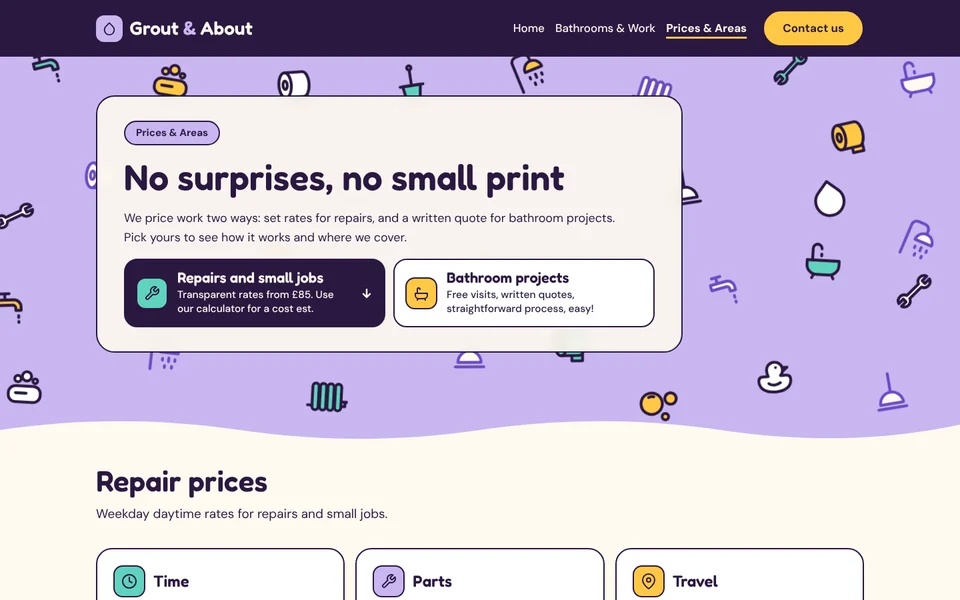 |
| Contact us | 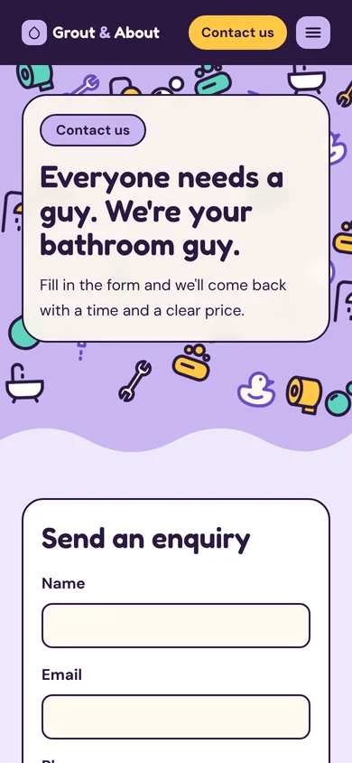 | 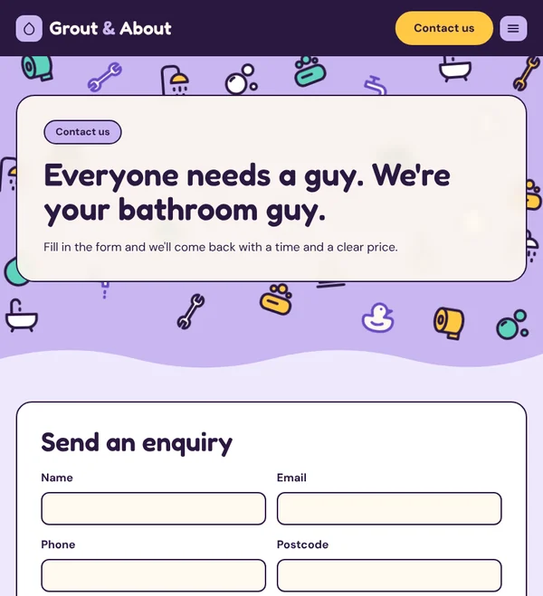 | 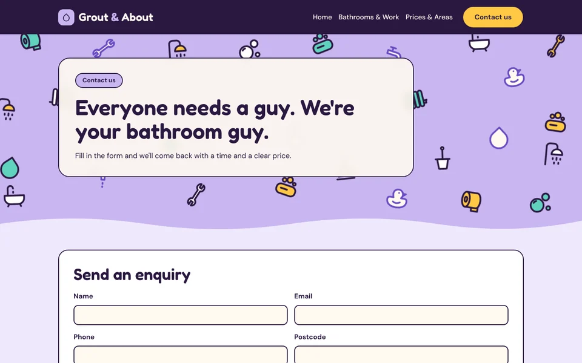 |
| Thank you | 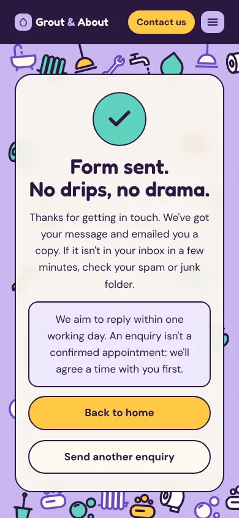 | 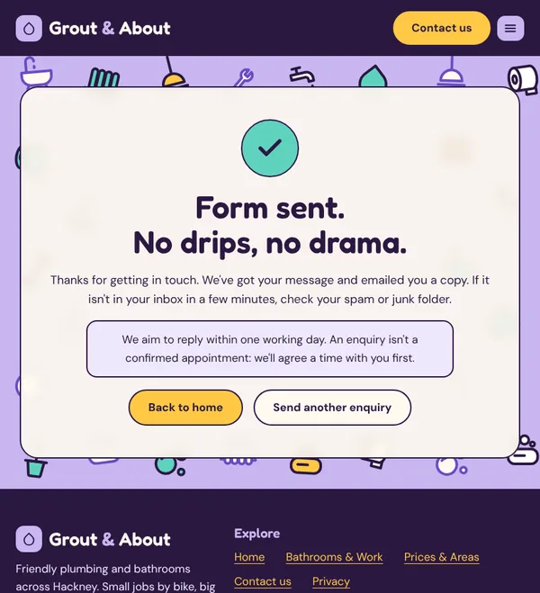 | 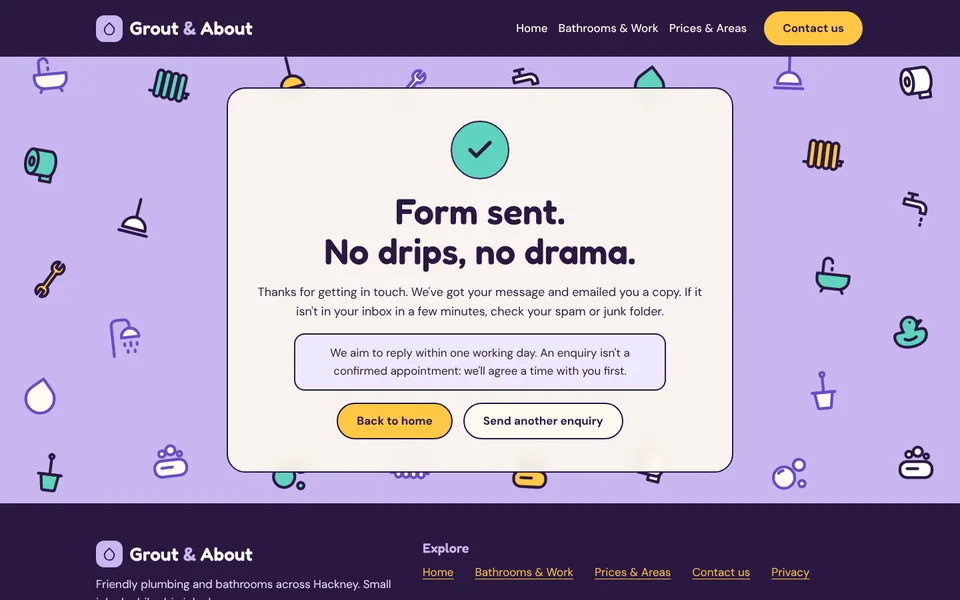 |
| Privacy | 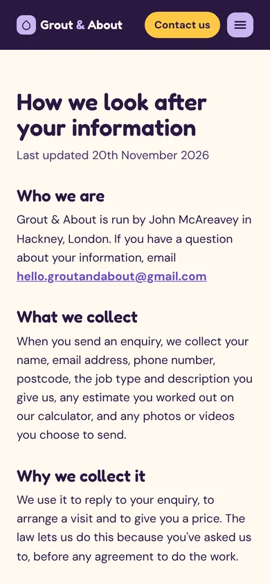 | 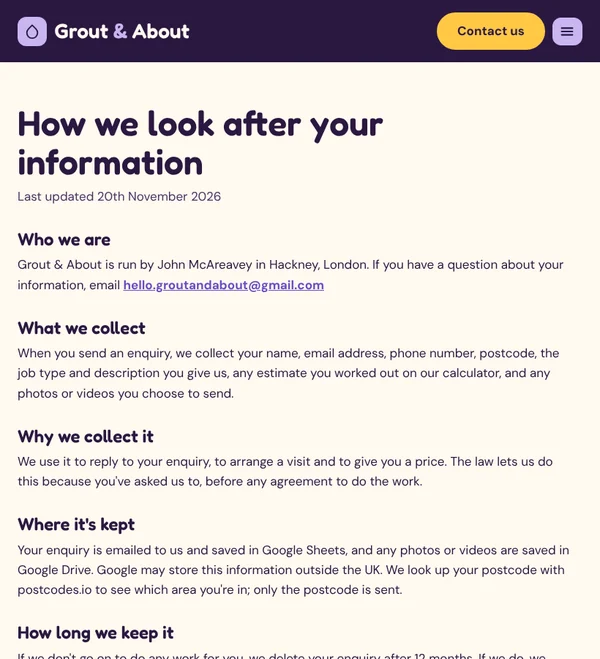 | 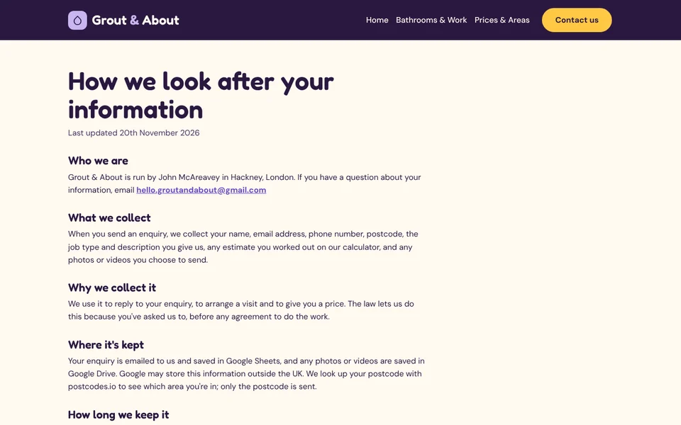 |

---

## Browser compatibility

| Browser | Device | Result |
|---|---|---|
| Chrome 153 | Desktop (automated, all tests on this page) | Pass |
| Safari | Mac | Not yet tested |
| Safari | iPhone | Not yet tested |
| Firefox | Desktop | Not yet tested |
| Edge | Desktop | Not yet tested |

The hero wave uses CSS `mask`, and the frosted card uses `backdrop-filter`, so Safari and Firefox are worth checking by hand before submission.

---

## User story testing

| Story | Test | Expected | Result |
|---|---|---|---|
| 1. Navigation and responsive layout | Open each page from the navbar and the footer at 390px, 820px and 1440px | Every link works, the current page is underlined, the burger menu appears below 992px with Contact us still showing, and there's no sideways scrolling | Pass. 80 links checked, none broken |
| 2. Hero and service cards | Open each "What's included" drop-down on the home page | Each opens on its own, the one before closes, and the other cards in the row stay the same size | Pass |
| 3. Clear pricing | Read the price cards and "How we charge, in full", then try the calculator | Rates, travel charges and VAT are stated, and the calculator total matches the rates | Pass. All 12 combinations correct (below) |
| 4. Enquiry form | Submit the form empty, with bad values, then with good values, with and without photos and videos | Empty and bad fields are flagged before sending. A good enquiry is sent and the visitor sees the thank-you page | Pass. Tested live on 20 November 2026 (see [Real enquiry from the live site](#real-enquiry-from-the-live-site)) |
| 5. Accessible design | axe-core, keyboard, contrast and image checks above | No violations, every tab stop visible, AA contrast, every image has alt text | Pass |
| 6. Project examples | Click through each project carousel | Five photos per project, counter updates, captions and labels show | Pass |
| 7. Service area map | Click Check the map and See the price map | The map opens and the page scrolls to it. The zones match the cards | Pass |
| 8. About the owner | Open Bathrooms and Work | Bio, three chips and a carousel with headshot, video and radiator photo | Pass |

---

## JavaScript feature testing

### Repair visit calculator

Every combination of area and job length was clicked through and the total checked against the rule: £85, plus £40 for each half hour after the first hour, plus travel.

| Area | 1 hr | 1½ hrs | 2 hrs | 3 hrs |
|---|---|---|---|---|
| Local (no travel fee) | £85 Pass | £125 Pass | £165 Pass | £245 Pass |
| Up to 20 mins (£30) | £115 Pass | £155 Pass | £195 Pass | £275 Pass |
| Further out (£50) | £135 Pass | £175 Pass | £215 Pass | £295 Pass |

### Other features

| Feature | Test | Result |
|---|---|---|
| Slide counter | Press next five times on a project carousel, then previous once | Pass. "2 of 5", "3 of 5", "4 of 5", "5 of 5", "1 of 5", then "5 of 5" |
| Carousel preloader | Throttle the connection to 1.5 Mbps, scroll to the first project, wait 10 seconds | Pass. 5 of 5 photos ready before the first click (1 of 5 without the preloader) |
| Check the map, map closed | Click Check the map | Pass. Map opens and its heading bar ends at the top of the window |
| Check the map, map open | Click it again | Pass. Scrolls straight back to the map |
| See bathroom projects | Click it from the repairs tab | Pass. Bathroom projects tab opens |
| See repair prices | Click it from the bathroom projects tab | Pass. Repairs tab opens |
| Form, empty | Press Send enquiry with nothing filled in | Pass. Name is flagged first and nothing is sent |
| Form, sending | Fill in every field correctly and send (with Apps Script not yet set up) | Pass for the error path. Button shows "Sending…", then "Sorry, that didn't send. Please try again in a few minutes." and the button comes back |

### Photo and video uploads

Tested with Google's address swapped for a stand-in that records what the form sends and replies `{ "ok": true }`.

| Test | Expected | Result |
|---|---|---|
| Add one photo, then type a comment | One row, "Photo 1: leak-photo.jpg". The button changes to "Add another photo or video" | Pass |
| Add a video on its own | A second row is added. The first row and its comment stay | Pass |
| Add a photo and a video at once | Both are added as rows 3 and 4 | Pass |
| Remove row 2 | The rows renumber (1, 2, 3), the other comments stay, "Video removed." shows and focus returns to the Add button | Pass |
| Add a 21MB video | Not added. "Not everything was added: big.mp4 would take your videos over 20MB, so try a shorter clip." | Pass |
| Add 4 files, then 3 more | Only 6 are kept. The button reads "6 files added" and is turned off, with a message saying only 6 can be added | Pass |
| Remove one of the 6 | The button turns back on | Pass |
| Add the same file twice in a row | Added both times | Pass |
| Type "  Water under the sink  " as a comment and send | The comment is sent trimmed, as "Water under the sink" | Pass |
| Send a 1MB photo (4032 by 3024 pixels) | Sent as a JPEG of 1600 by 1200, 148KB | Pass |
| Send a transparent PNG | Sent as a JPEG with a white background, not black | Pass |
| Send a video | Sent as it is, plus a JPEG still no more than 1600px on its longest side | Pass |
| Send a HEIC photo, which Chrome can't open | "Sorry, we couldn't open phone-photo.heic. Please try a JPEG or PNG photo." Nothing is sent and the button comes back | Pass |
| Send with no files | `files` is sent as an empty list | Pass |
| Tab from the job description | Focus lands on the Add button, with a visible outline | Pass |
| The hidden bot field | Sent empty, and never reached with the Tab key | Pass |

After adding the uploads, the Contact us page still has no HTML errors or warnings, no axe-core violations and no sideways scrolling at 390px. Lighthouse scored 80 (mobile) and 98 (desktop) for Performance and 100 for the other three.

### Postcode and email checks

| Typed | Accepted by the browser? | Correct? |
|---|---|---|
| `E8 4DA` | Yes | Yes |
| `e84da` | Yes | Yes, the script turns it into capitals |
| `N1C 4AG` | Yes | Yes |
| `SW1A 1AA` | Yes | Yes |
| `E8` | No | Yes |
| `E8 4D` | No | Yes |
| `12345` | No | Yes |
| `sam@example.com` | Yes | Yes |
| `sam.example.com` | No | Yes |
| `sam@example` | Yes | The browser allows an address with no dot after the @. The Apps Script check rejects it |

---

### Calculator estimate on the form

Tested in Chromium with Playwright, against a stand-in for the Apps Script web app. 23 checks, all pass. After the change, `prices.html` and `contact.html` have no HTML errors or warnings, and JSHint has no warnings for `main.js`.

| Test | Result |
|---|---|
| Send an enquiry link when Prices and Areas opens | Pass. `contact.html?area=near&minutes=90`, matching the options picked by default |
| Pick Further out and 3 hrs, then Local and 1 hr, then Up to 20 mins and 2 hrs, and press Send an enquiry each time (4 checks each) | Pass. The link changes each time, the form shows the same total as the calculator (£295, £85, £195), the area and job length are shown, and the hidden fields are filled |
| Edited addresses: `area=moon`, area missing, minutes missing, `minutes=75`, `area=__proto__`, `area=toString&minutes=constructor`, and no query string at all | Pass. Nothing shown and the hidden fields stay empty, in all 7 |
| Send from `?area=far&minutes=180` | Pass. `area` "far" and `minutes` "180" go with the enquiry |
| Send from plain `contact.html` | Pass. `area` and `minutes` are sent empty |
| JavaScript errors on the page | Pass. None |

Still to do: send a real enquiry from the live site through the calculator once the updated script is deployed.

## Apps Script testing

The Apps Script code was run in Node.js with stand-in versions of Google's services (Sheets, Drive, Mail, UrlFetch and the PDF conversion), so its logic could be tested before it's set up in a Google account. All 50 tests pass.

| Area | What was tested |
|---|---|
| A good enquiry (8 tests) | Replies ok, sends two emails, John's email replies to the customer and the customer's replies to John, estimate £85 + £40 + £30 = £155, ward appears in John's email, HTML in the description is escaped, PDF attached, customer greeted by first name, row logged with its status |
| Protection (5 tests) | Honeypot replies ok but sends and logs nothing, bad fields are listed back, a fourth enquiry in a day is refused, enquiries older than 24 hours don't count, a broken request gets a friendly error |
| Limits (2 tests) | With no email allowance left, the enquiry is logged as not emailed and the visitor still gets ok. A tampered estimate is ignored and worked out again |
| Outside services (1 test) | If postcodes.io is down, the enquiry still goes through |
| Uploads (14 tests) | Photos and videos saved, other file types and tampered data skipped, comments trimmed, cut to 100 characters, escaped and saved as file descriptions, Drive link in John's email, photos embedded in the PDF, a video's still frame used instead of the video, a video with no still says so, no photos section when none were sent, 7 files refused, 26MB refused |
| Editor test (1 test) | `testEnquiry` sends both emails |
| Calculator estimate (11 tests) | For three area and time pairs (£155, £85 and £295), the travel zone, job length, estimate and its breakdown appear in both emails and the PDF, and the Area, Time and Estimate columns are filled. With no estimate, both emails and the PDF say so. Edited values, including built-in object names like `toString` and `__proto__`, give no estimate but the enquiry still goes through, and `__proto__` as a job type is refused |
| Greeting (8 tests) | "Sam Jones" is greeted as Sam, "Mr J Smith" as Mr Smith, "Dr. Ana Lee" as Dr Lee, "J Smith" as J Smith, and a one-word name as itself |

### Real test in Google

On 20 November 2026 at 16:51, `testEnquiry` was run from the Apps Script editor with the script set up in the business Google account.

| Check | Result |
|---|---|
| Business email arrives, subject "New enquiry: Small repair in E8 4DA" | Pass |
| Ward and borough looked up from the postcode ("London Fields, Hackney") | Pass |
| Estimate worked out by the script (£155 + parts, up to 20 mins away, 1½ hrs) | Pass |
| Customer email arrives, greeted by first name, subject "Thanks, Test: we've got your enquiry" | Pass |
| PDF summary attached to both emails, with reference GA-1120-1651 | Pass |

### Real enquiry from the live site

On 20 November 2026 at 19:55, an enquiry was sent from the live site with two photos, each with a comment, using a personal email address as the customer.

| Check | Result |
|---|---|
| The form sends and goes to the thank-you page | Pass |
| Business email arrives, subject "New enquiry: Full bathroom installation in" the postcode | Pass |
| Ward and borough looked up from the postcode | Pass |
| "2 in Drive" links to a new folder named with the reference and name, holding both files | Pass |
| PDF shows both photos, each with its comment | Pass |
| No estimate sent, so the business email says "They didn't use the calculator" | Pass. The form didn't carry the calculator estimate yet (see [fixed bugs](#fixed-bugs)) |
| Customer email arrives | Pass, but it went to the customer's Spam folder (see [known issues](#known-issues)) |
| Customer greeted by first name | Fail: the name was typed as "Mr" plus an initial and surname, so the greeting said "Hi Mr," and the subject "Thanks, Mr:". Fixed, see [fixed bugs](#fixed-bugs) |

Screenshots are in the README under [What the emails look like](README.md#what-the-emails-look-like), with the sender's personal details hidden. Still to check: pressing Reply on the business email goes to the customer's address.

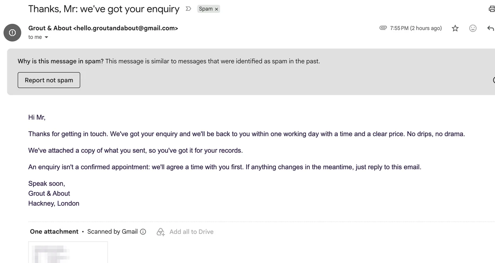

---

## Bugs

### Fixed bugs

| Bug | Cause | Fix |
|---|---|---|
| Cream strip under the wave on the Contact page | The CSS mask makes the wave see-through, and the cream page background was behind it | Slid the enquiry section 48px up behind the hero ([details](README.md#1-the-wave-on-the-contact-page-was-the-wrong-colour)) |
| Thank-you page icons bunched on the right | Icon positions suited a left-hand card, but this card is centred | Rebuilt the icon layer in zones, with right-hand icons measured from the right ([details](README.md#2-the-thank-you-page-icons-were-bunched-up-on-the-right)) |
| White blocks when moving to the next carousel photo | Lazy-loaded photos in hidden slides only start downloading when shown | IntersectionObserver loads each carousel's photos as it nears the screen ([details](README.md#3-white-blocks-in-the-carousels)) |
| Check the map scroll stopping short | The scroll started before the map had finished opening | Scroll after `shown.bs.collapse` ([details](README.md#4-check-the-map-stopped-short)) |
| Very tall footer on phones | Three columns of stacked content | One row of wrapping links ([details](README.md#5-a-very-tall-footer-on-phones)) |
| Screen readers could ignore the carousel labels | `aria-label` on a `div` with no role | Added `role="region"` and `aria-roledescription="carousel"` |
| No meta descriptions | Never added | A short description in each page's `<head>` |
| "404 favicon.ico" error on every page | No favicon | Added an SVG favicon, a 32px PNG and an iPhone home screen icon |
| An unused Font Awesome script on every page | Left over from the first plan, once the icons became custom SVGs | Removed the script from all six pages |
| Six JSHint style warnings | Functions declared inside `if` blocks, and ternaries split over lines | Arrow functions, and short one-line labels |
| Short alt text on the first project's photos ("Bathroom1 mid work") | Placeholder text never replaced | Each photo now describes what it shows. The headshot, soldering photo and video labels were improved too |
| The first project's dots said "project 2" and "project 3" | The project is one house with two bathrooms and a WC | Labels now say "Show bathroom 1 in progress", "Show the finished WC" and so on |
| Calculator estimate didn't reach the form (live test, 21 November) | Send an enquiry on the calculator was a plain link to `contact.html`, so the area and time weren't passed on | The link now carries the area and time, the form shows the estimate and sends both, and the emails and PDF show the travel zone, job length and price breakdown. 23 browser checks and 8 new script tests |
| Built-in names got past the checks | `areas[area]` is also true for names every object has, like `toString` or `__proto__`, so an edited address showed a broken estimate, and a crafted request with `__proto__` as the job type passed the script's check | `main.js` and the script now check the value is one of their own keys with `Object.keys(list).includes(key)`. 3 new tests |
| Customer email greeted a live tester as "Hi Mr," | The script used the first word of the name, which was a title | A new `greetingName_` function skips titles ("Mr J Smith" becomes "Mr Smith") and keeps the full name when the first word is an initial. 8 new tests |

### Known issues

| Issue | Effect | Suggested fix |
|---|---|---|
| The customer's email can land in Spam | In the live test, Gmail put the customer's copy in Spam, so a customer might think nothing arrived | Add a line to the thank-you page asking people to check their spam folder. Each "Not spam" helps Gmail learn |
| Carousel dots are small | Harder to tap on a phone. Lighthouse Accessibility 96 on Bathrooms and Work | Make the dot buttons at least 24px with spacing |
